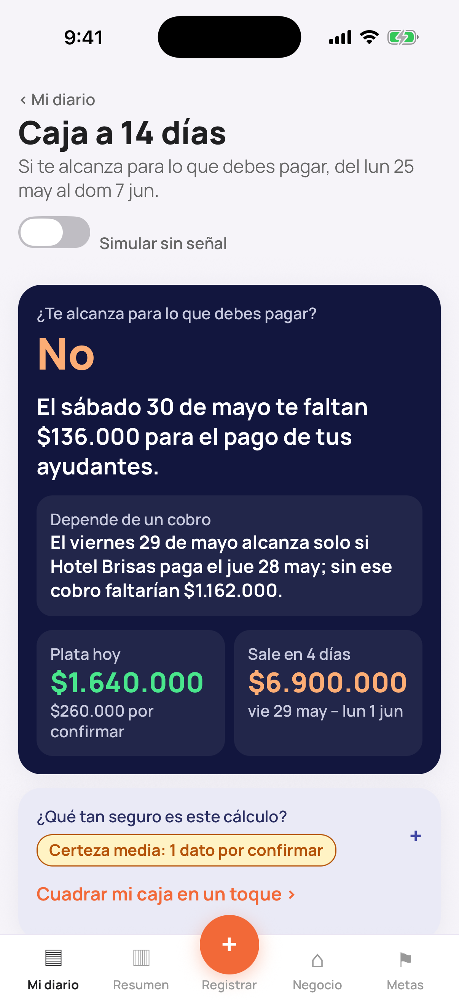
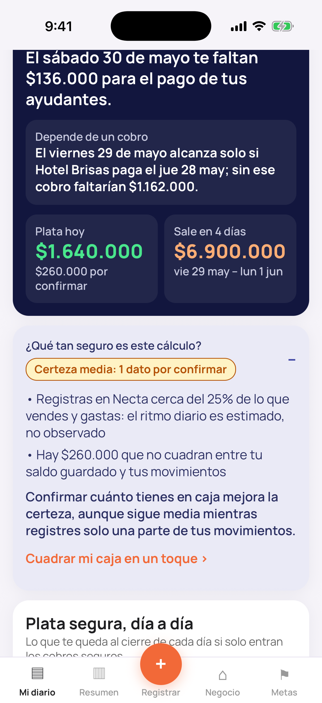
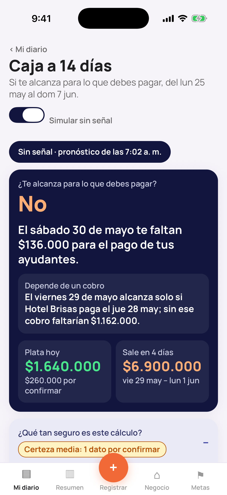
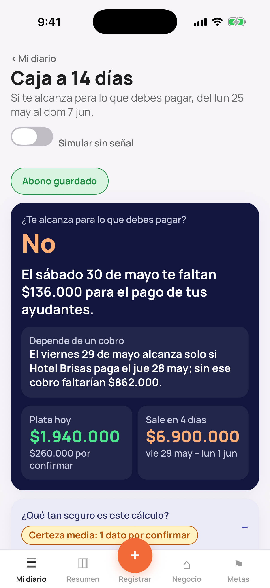

# «Caja a 14 días» · prueba técnica para Agora / Necta

[](https://github.com/santiagoPadi/prueba-tecnica-agora/actions/workflows/ci.yml)

Pronóstico de caja día a día para las dueñas de negocios pequeños que usan Necta: **¿me alcanza el viernes o pido plazo? ¿a quién le cobro primero?** Este repositorio contiene los tres entregables de la prueba técnica: la especificación completa de la feature en **OpenSpec**, una **implementación parcial** (pantalla React Native con el motor de cálculo dentro, y diagrama de arquitectura) y la **presentación con su guion** para el video.

Caso de referencia: Carmen Ortiz, Limpia Ya, Barranquilla, lunes 25 de mayo de 2026 (datos ficticios del enunciado «Pruebas técnicas» de Agora, que no se incluye en el repo; las cifras del caso están en [`design.md` §6.14](openspec/changes/caja-a-14-dias/design.md) y en [`app/src/engine/fixtures/carmen.ts`](app/src/engine/fixtures/carmen.ts)).

Autor: Santiago Pachón Díaz.

## Entregables

| Entregable | Dónde | Qué hay |
| :--- | :--- | :--- |
| 1 · Especificación OpenSpec | [`openspec/changes/caja-a-14-dias/`](openspec/changes/caja-a-14-dias/) | [`proposal.md`](openspec/changes/caja-a-14-dias/proposal.md) (por qué, qué cambia, 6 capacidades, impacto, alcance por capa, métricas, riesgos, decisiones), [`design.md`](openspec/changes/caja-a-14-dias/design.md) (14 decisiones con alternativas descartadas; arquitectura, datos, contratos, el cálculo en 9 pasos, avisos, sin señal, seguridad, observabilidad, pruebas; postura sobre los 7 puntos del caso), [`tasks.md`](openspec/changes/caja-a-14-dias/tasks.md) (73 tareas en 12 grupos con dependencias, talla, rol y verificación; 5 fases) y seis specs delta en [`specs/`](openspec/changes/caja-a-14-dias/specs/) con **33 requisitos y 129 escenarios WHEN / THEN** |
| 2 · Implementación parcial: pantalla en React Native | [`app/`](app/) | Una pantalla Expo con la identidad de Necta que le responde a Carmen (sol · una mano · poca señal), con el motor de cálculo dentro, estado optimista y cola de sincronización simulada; `npm test` → 66 pruebas; verificada en el simulador iOS |
| 2 · Implementación parcial: diagrama de arquitectura | [`arquitectura/`](arquitectura/) | Excalidraw (`.excalidraw`, `.svg`, `.png`): qué corre en el teléfono, en la web y en el servidor, datos, integraciones, fallas y el flujo de un abono sin señal |
| 3 · Video (≤ 10 min) | [`presentacion/`](presentacion/) y [`video/guion.md`](video/guion.md) | 17 diapositivas (HTML autocontenido y [PDF](presentacion/caja-a-14-dias.pdf)) y el guion con tiempos: la solución, el motor por dentro, el flujo del diagrama, la pantalla en vivo, tiempo invertido, prompts y las preguntas de la prueba |

El backend, PowerSync, la web y los avisos **no se construyeron**: quedan especificados (endpoints, colecciones, sync rules, jobs, avisos y fallas) en `design.md` y `tasks.md`, y el prototipo simula la cola de sincronización en memoria. La prueba pide una implementación parcial a elección; aquí se eligieron la pantalla y el diagrama, y el tiempo invertido se declara en el guion.

<p>
  
  
  
  
</p>


## Estructura del repositorio

```
.
├── openspec/                        Entregable 1 (OpenSpec 1.14.2, esquema spec-driven)
│   ├── config.yaml                  contexto del proyecto y reglas por artefacto
│   ├── specs/                       vacío a propósito: la verdad vigente se llena al archivar (ver «Notas sobre OpenSpec»)
│   └── changes/caja-a-14-dias/      el cambio propuesto
│       ├── proposal.md · design.md · tasks.md
│       └── specs/cashflow-{forecast,capture,ui,offline-sync,notifications,operations}/spec.md
├── app/                             Entregable 2: pantalla Expo + motor TypeScript + 66 pruebas Jest
├── arquitectura/                    Entregable 2: diagrama (Excalidraw, SVG, PNG)
├── presentacion/                    Entregable 3: 17 diapositivas (index.html + PDF) y capturas
├── video/guion.md                   Entregable 3: guion del video con tiempos, prompts y respuestas
├── .claude/                         skills y comandos /opsx:* generados por `openspec init --tools claude`
└── .github/workflows/ci.yml         `openspec validate --all --strict` + typecheck y pruebas de la app
```

## Cómo verificarlo

```bash
# OpenSpec 1.14.2 (Node >= 20.19). Alternativa sin instalar: npx -y @fission-ai/openspec@1.14.2 <comando>
npm i -g @fission-ai/openspec@1.14.2
openspec validate --all --strict           # el cambio y sus 6 specs delta, en modo estricto (lo mismo que corre CI)
openspec status --change caja-a-14-dias    # 4/4 artefactos completos; siguiente paso: apply
openspec list                              # cambios activos
openspec list --specs                      # vacío: nada archivado todavía
openspec show caja-a-14-dias --type change --deltas-only   # los 33 requisitos ADDED por capacidad
openspec doctor
```

```bash
cd app && npm ci && npm run typecheck && npm test   # 66 pruebas en 8 archivos (motor con el caso de Carmen, outbox, contraste, pantalla)
npx expo start --ios                                # simulador iOS (Expo Go); «a» para Android
```

```bash
open presentacion/index.html          # 17 diapositivas; navegación con flechas
open arquitectura/caja-a-14-dias.svg  # fuente editable: el .excalidraw en excalidraw.com
```

## Las respuestas para Carmen (lunes 25 de mayo)

- **¿Me alcanza el viernes o pido plazo?** Alcanza (cierra con $938.000) **solo si Hotel Brisas paga el jueves como siempre**; sin ese cobro faltarían $1.162.000. El motor propone pedirle plazo al proveedor por si acaso, con el mensaje listo.
- **El hueco real** llega después: el sábado 30 faltan $136.000 para los ayudantes y el lunes 1 el hueco es de $1.318.000 por el arriendo. Entre el viernes y el lunes salen $6.900.000. El cálculo ingenuo (+$7.004.000) no aparece en ninguna banda.
- **¿Qué tan seguro?** Certeza media: registra el 25 % de sus movimientos y hay $260.000 sin cuadrar; cuadrarlos en un toque la sube a 0,62 y deja el lunes en $1.058.000.
- **¿A quién le cobro primero?** Recordarle a Hotel Brisas (asegura el viernes); cobrarle a Tienda La Esquina antes del martes; recordarle a Doña Fina; después las otras tiendas, un abono parcial de Minimercado Sol, cuadrar el saldo y pedir plazo preventivo.
- **Sin señal:** ve el último pronóstico con su hora, registra un abono y la pantalla se recalcula en el acto con el mismo motor; al volver la señal se sincroniza sin duplicados.

## Dónde se profundizó

Profundo: el cálculo (Punto 1), sin señal e idempotencia (Punto 4) y cómo lo ve Carmen (Punto 3a), construidos y probados en la app. Medio: avisos y recomendaciones (3b, 3c) y datos de otras tiendas (5). Superficial: nivel de IA (2), costo (6) y tecnologías (7), con postura y órdenes de magnitud. Así lo pide la prueba («elige dónde profundizar y dilo»).

## Notas sobre OpenSpec

- **Versión y flujo.** OpenSpec 1.14.2 con el esquema `spec-driven`. El cambio se creó con `openspec new change caja-a-14-dias --goal …` (16 de octubre de 2026) y sus cuatro artefactos siguen el orden del flujo: `proposal` → `specs` → `design` → `tasks`. Se valida en modo estricto en cada push (`.github/workflows/ci.yml`). Los artefactos están en español; los encabezados estructurales y las palabras clave SHALL / MUST / WHEN / THEN se conservan en inglés, como fija `openspec/config.yaml`.
- **Seis capacidades, no una.** `cashflow-forecast` (el cálculo), `cashflow-capture` (ritmo, pagos fijos, compromisos), `cashflow-ui` (pantalla, tarjeta, web), `cashflow-offline-sync` (sin señal, idempotencia, errores, aislamiento por tienda), `cashflow-notifications` (avisos, preferencias, consentimiento) y `cashflow-operations` (snapshot, historial, costo, rendimiento, telemetría, retención, bandera, observabilidad). Son unidades cohesionadas con nombre propio, como pide el esquema («evita capacidades cajón de sastre»); los 33 requisitos son ADDED porque son las primeras del proyecto.
- **Por qué `openspec/specs/` está vacío.** En OpenSpec, `specs/` guarda la verdad vigente (lo que existe) y `changes/` los deltas propuestos. Este cambio no está implementado (7 de 73 tareas, las del prototipo), así que no se archiva: `openspec archive` crearía los seis `specs/cashflow-*/spec.md` como si estuvieran en producción. La sección «Workflow follow-up» de `tasks.md` dice cuándo y cómo archivar.
- **Por qué no hay Modified Capabilities.** Necta no tiene specs OpenSpec de sus sistemas existentes (abonos, bancos, notificaciones, voz), así que no hay un spec base sobre el que escribir un delta MODIFIED. Lo que cambia en ellos (idempotencia de los abonos, cuadre rápido, plantilla de WhatsApp) se declara en **Impact** y se especifica como requisitos ADDED; cuando esos sistemas tengan su spec, pasarán a MODIFIED.
- **Layout de los specs.** El enunciado pide `specs/<capacidad>/spec.md`, que es también lo que exige el CLI: OpenSpec 1.14.2 rechaza un `specs/spec.md` plano («Delta spec found at specs/spec.md»). Los specs describen comportamiento, no implementación: PowerSync, MongoDB, colecciones, índices y endpoints internos viven en `design.md`.
- **Continuar con Claude Code.** `.claude/` trae las skills y los comandos `/opsx:propose`, `/opsx:apply`, `/opsx:archive`… generados por `openspec init --tools claude`; `/opsx:apply caja-a-14-dias` retoma las tareas pendientes en el orden de las fases.

## Tiempo invertido y uso de IA

Está en [`video/guion.md`](video/guion.md): secciones 13 y 14 (tiempo real, prompts clave y el caso en que la IA propuso algo inadecuado y se corrigió con criterio propio) y el Anexo B con los prompts completos.
