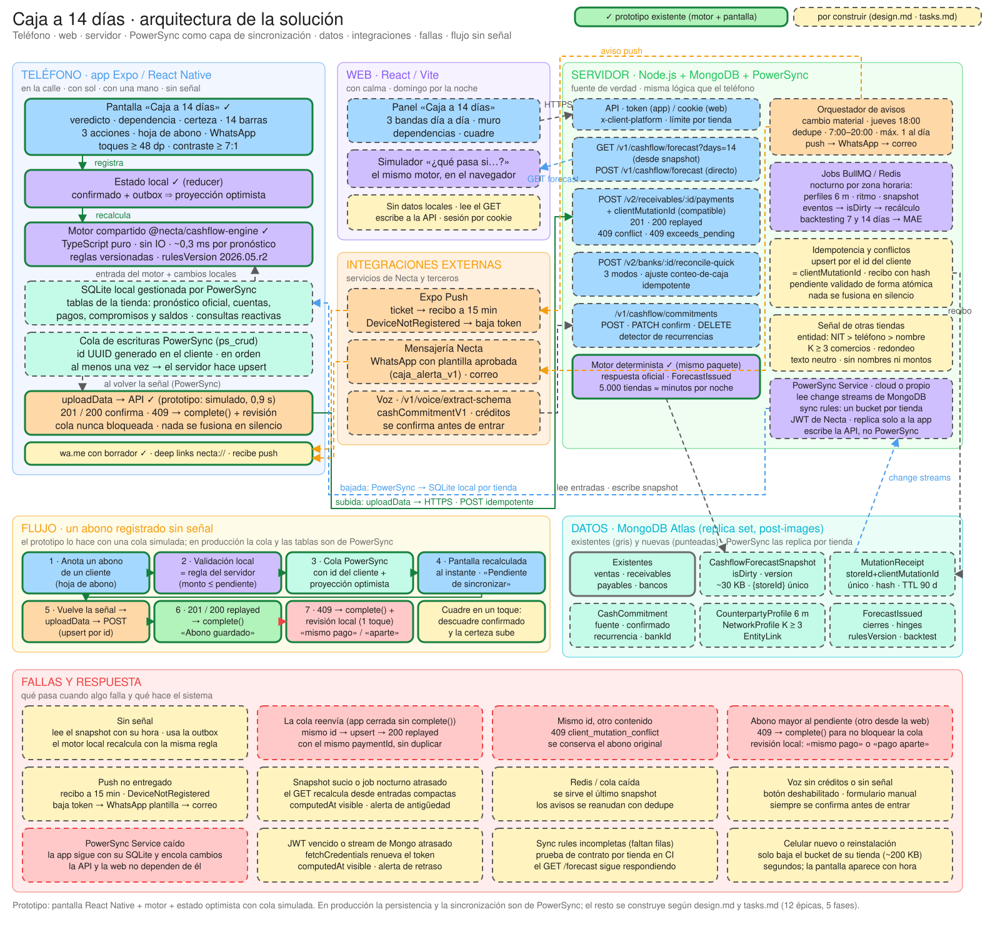
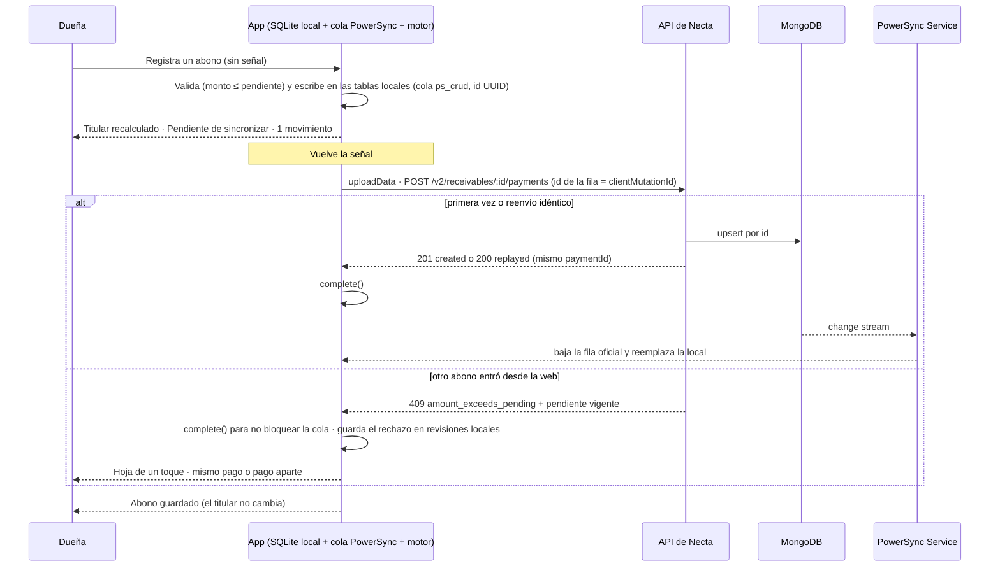

# Diseño técnico: Caja a 14 días

> Diseño de las capacidades `cashflow-*` («Caja a 14 días») para **cualquier tienda de Necta, en cualquier fecha**: miles de dueñas que venden a crédito, registran solo una parte de sus movimientos y trabajan con poca señal. Cubre motor, API, datos, sincronización, app, web, avisos, señal de otras tiendas, operación y despliegue, con decisiones, alternativas descartadas y fallas por integración. Carmen Ortiz (Limpia Ya, Barranquilla, lunes 25 de mayo de 2026) es el ejemplo con el que se levantaron los requisitos y el caso de referencia del motor; aparece solo en bloques marcados *Ejemplo (caso Carmen)*, con cifras que salen del motor. Diagrama de arquitectura: `arquitectura/` (Excalidraw, SVG y PNG).

## Context

### 0. Estado de partida

Hay un prototipo (`app/`); este documento diseña todo lo demás:
- **Motor:** TypeScript puro en `app/src/engine` (~1.400 líneas, sin IO, reglas `2026.05.r2`), probado con el caso de referencia y por módulo.
- **Pantalla:** una vista React Native/Expo que pinta cualquier `ForecastResponse`, con estado optimista y cola simulada en memoria (sin PowerSync ni servidor).
- **Diagrama:** `arquitectura/` (Excalidraw, SVG y PNG).
- **Falta:** backend, colecciones, sync rules, jobs, avisos, web, onboarding del ritmo y captura de compromisos.
- El motor y la pantalla se reutilizan tal cual; cambia de dónde salen los datos (SQLite sincronizada por PowerSync, no una fixture) y quién confirma las escrituras (la API, no un servidor simulado).
- Secuencia de construcción: fases F0–F4 y épicas E1–E12 (Migration Plan, §15).

### 0.1 Restricciones y contratos existentes

Motivación: ver `proposal.md › Why`.

- **Para quién:** cualquier dueña de negocio en Necta. El motor recibe los datos de una tienda (saldos, cuentas por cobrar con su historial, pagos, pagos fijos y ritmo de ventas) y una fecha base, y responde para esa tienda y esa fecha. No hay nada de Carmen en el código fuera de la fixture de prueba.
- Backend Node.js + MongoDB; app React Native/Expo (sesión por token); web React/Vite (sesión por cookies); cada cliente se identifica con `x-client-platform`.
- Contratos reales que se respetan: `storedLedgerBalance`, `projectedBalance`, `alignmentDelta`, `counterpartyName`, `pendingAmount`, `creditDueBy`, `clientMutationId`. `GET /v2/banks/:id/projection` **no proyecta**: reconstruye el saldo de hoy.
- Hoy no hay cola de envío ni datos para leer sin conexión; los recordatorios push no evalúan si la caja alcanza y no llegan a la web; WhatsApp solo se usa para códigos.
- **Sincronización:** PowerSync como capa de persistencia local y transporte en la app (SQLite en el teléfono, sync rules por tienda, cola de escrituras hacia la API de Necta); la web va directo contra la API.
- **Caso de referencia y estado del prototipo:** los escenarios del spec con nombres y cifras usan el caso de Carmen como datos de ejemplo verificables (marcados *ejemplo: caso Carmen*); el prototipo ya satisface los escenarios del cálculo, de la pantalla y del estado sin señal; los demás son criterios de aceptación para el equipo.

## Goals / Non-Goals

**Goals:** que la dueña vea con una semana de anticipación si la caja cubre lo que debe, qué tan seguro es, y a quién cobrar o qué pago negociar; que funcione sin señal; que se lea con el sol encima y con una mano; que no mienta con un espejismo.
**Non-Goals:** asesoría crediticia; que un modelo decida cifras; exponer datos de otra tienda; sustituir el cuaderno o la contabilidad; pagos o negociaciones automáticas; captura de ventas sin señal por la misma cola (extensión posterior).

## Decisions

### Decisiones principales y alternativas descartadas

| # | Decisión | Alternativa descartada y por qué |
| :-- | :--- | :--- |
| 1 | **Tres bandas día a día** (plata segura, probable, favorable); cada cobro entra entero en una fecha distinta por banda. | Un solo número con «margen ±» (oculta el día que importa); ponderar cada cobro por probabilidad (nadie recibe el 85 % de una factura; suaviza justo el riesgo del día de pago). |
| 2 | **Un motor TypeScript puro compartido** por servidor, web y teléfono, con `rulesVersion` en cada respuesta. | Calcular solo en el servidor (sin señal no hay nada); calcular en el teléfono con otra lógica (dos resultados distintos para la misma dueña). |
| 3 | **La IA no decide cifras**: reglas deterministas para montos, fechas y prioridades; IA para voz, mensajes y sugerencias con confirmación. | Un modelo de lenguaje que «razone» la caja (alucina, no corre sin señal, consume créditos, no es auditable); un modelo estadístico (26 semanas de una tienda con 25 % de registro: sobreajusta). |
| 4 | **Partir del saldo que dan los movimientos** y mostrar el descuadre como plata por confirmar con cuadre de un toque. | Usar el guardado (infla la caja), promediar (una cifra que no coincide con nada), exigir conciliación antes (frena el uso en ruta). |
| 5 | **Nombrar las dependencias** (`hinges`): «ese día alcanza solo si tal cliente paga», con acción preventiva de pedir plazo. | Mostrar solo el saldo del día de pago (positivo) sin decir de qué cobro depende: responde la pregunta equivocada. |
| 6 | **Nada se fusiona en silencio** sin señal: idempotencia por `clientMutationId`, `409` explícito y la dueña decide. | Último en escribir gana también para dinero (duplica o borra abonos); fusión automática de montos (nadie sabe qué pasó). |
| 7 | **Proyección optimista en el teléfono**: las escrituras locales se aplican de inmediato y el mismo motor recalcula al instante; la validación local es la misma regla del servidor. Con PowerSync es el comportamiento nativo: la cola conserva el cambio hasta que el servidor lo confirma. | Bloquear la captura sin señal (hoy la app «no guarda nada»); guardar sin recalcular (la tarjeta mentiría hasta que vuelva la señal); validar solo en el servidor (el error llega horas después, cuando la dueña ya no recuerda el pago). |
| 8 | **Una sola columna, el titular primero, tres acciones y la hoja de abono desde abajo**; cifras ≥ 7:1 sobre la paleta real de Necta; toques ≥ 48 dp. | Un tablero con gráfica de líneas y tabla de 14 días (ilegible al sol y a dos manos); esconder el veredicto detrás de un gráfico; colores de marca sin verificar contraste. |
| 9 | **Un pronóstico precalculado por tienda** (`CashflowForecastSnapshot`): el `GET` lee un documento; los eventos lo recalculan y el job nocturno lo reconstruye. | Calcular en cada `GET` desde 90 días de movimientos (a las 7:00 abren todas a la vez); solo el job nocturno (queda viejo tras un abono). |
| 10 | **PowerSync como capa de sincronización de la app**: SQLite local en el teléfono, sync rules por tienda y cola de escrituras hacia nuestra API; la idempotencia, los `409` y el recálculo siguen en nuestro código. La web no lo usa: lee la API y escribe a los mismos endpoints idempotentes. | Outbox propia (es lo que hace el prototipo y sirve para mostrar el razonamiento, pero mantener un motor de sincronización es un producto aparte); WatermelonDB (hay que escribir y mantener el protocolo pull/push en el servidor); Atlas Device Sync (MongoDB lo descontinuó en 2025); ElectricSQL (solo Postgres); Firestore (una segunda base de datos); PowerSync también en la web (mismo código, pero SQLite en WASM, workers y cabeceras especiales para resolver un problema que la web, usada con calma y con conexión, no tiene). |
| 11 | **Un orquestador de avisos** con estados, deduplicación, ventana horaria y escalada push → WhatsApp con plantilla → correo. | Que cada disparador envíe por su cuenta (duplicados, fatiga); SMS (sin enlace útil, costo); WhatsApp como canal principal (costo, consentimiento). |
| 12 | **Ritmo de ventas declarado al activar**, reemplazado por el historial cuando hay registro suficiente. | Esperar semanas de historial (el primer día no habría nada con un registro del 25 %); plantillas por rubro (cifras ajenas). |
| 13 | **Enlaces web firmados, de solo lectura y de corta vida** en los avisos por WhatsApp y correo. | Exigir inicio de sesión desde el enlace (la dueña no entra); enlaces con permiso de escritura (reenviados, mueven plata). |
| 14 | **La semana de quincena es la semana (lunes a domingo) que contiene el 15 o el 30** (`quincenaWeek`, §6.5), como exige el escenario «Otra tienda, otro horizonte» del spec. | «La semana siguiente al pago» (desplaza la subida fuera de los días en que las clientas cobran); si Necta la prefiere, cambia una regla versionada y sube `rulesVersion`. |

Las tres primeras son las que más consecuencias tienen: su detalle está en las secciones 6, 9 y 7; la 7, la 8 y la 10 en la 3 y la 9; la 9 en la 4 y la 17; la 11 en la 8; la 12 en la 3.2; la 13 en la 5.7 y la 18; la 14 en la 6.5.

### 1. Arquitectura



Fuente editable: [`arquitectura/caja-a-14-dias.excalidraw`](../../../arquitectura/caja-a-14-dias.excalidraw) (abrir en excalidraw.com). Borde verde continuo = existe en el prototipo; punteado = por construir.

**Zonas.** *Teléfono:* la pantalla, el estado optimista, el motor compartido, la SQLite local gestionada por PowerSync, su cola de escrituras, `uploadData` hacia la API y las salidas (WhatsApp, deep links, push). *Web:* panel de tres bandas con muro y dependencias y simulador que corre el mismo motor en el navegador sobre la respuesta del `GET`; sin datos locales. *Servidor:* API, pronóstico, abonos idempotentes, cuadre, compromisos, el mismo motor como respuesta oficial, orquestador de avisos, jobs, idempotencia, señal de otras tiendas y el PowerSync Service (cloud o propio) que lee los change streams de MongoDB y replica a cada tienda su bucket. *Datos:* colecciones existentes y nuevas. *Integraciones:* Expo Push, mensajería (WhatsApp con plantilla, correo) y voz. *Fallas:* los casos de §13 con la respuesta del sistema (el diagrama muestra los doce principales).

**Decisión clave (fila 2 de la tabla):** el motor es un paquete TypeScript puro sin IO. Lo ejecuta el servidor para la respuesta oficial de cada tienda, la app para recalcular sin señal sobre sus datos locales y la web para el simulador. Un solo código y un solo `rulesVersion`: lo que ve la dueña sin señal es lo que el servidor confirmará. El pie de la pantalla lo dice: «Reglas 2026.05.r2 · calculado en tu celular con los mismos pasos que el servidor».

**El flujo central: un abono registrado sin señal.**



#### 1.1 Componentes, dueños y estado

| Componente | Responsabilidad | Dueño | Estado |
| :--- | :--- | :--- | :--- |
| Motor `@necta/cashflow-engine` | Cálculo puro, reglas versionadas (§6) | Backend | Prototipo |
| API, snapshots y jobs | Pronóstico, captura, cuadre, abonos idempotentes, perfiles (§5, §17) | Backend | Por construir |
| Señal de otras tiendas y avisos | Entidad y K-anonimato; orquestador (§8, §10) | Backend | Por construir |
| Mensajería y push | WhatsApp con plantilla, correo, Expo Push | Plataforma | Existen; por ampliar |
| Atlas, Redis, BullMQ, PowerSync Service | Datos, colas, sincronización (§5.5) | Plataforma | Atlas existe; el resto por construir |
| Observabilidad y banderas | OpenTelemetry, Sentry, alertas, bandera por tienda (§19) | Plataforma | Por construir |
| App: pantalla y estado | Pantalla «Caja a 14 días», proyección optimista (§3.1) | Mobile | Prototipo |
| App: datos y captura | PowerSync, onboarding, tarjeta, compromisos, cuadre (§3.2–§3.8, §9.5) | Mobile | Por construir |
| Web | Panel, simulador, captura, preferencias (§3.9) | Web | Por construir |

### 2. Qué vive en el teléfono, en la web y en el servidor

| | Teléfono (app) | Web | Servidor |
| :--- | :--- | :--- | :--- |
| Cálculo | Recalcula con el motor sobre la entrada confirmada + outbox (optimista) al registrar algo, con o sin señal (prototipo) | Solo lee; el simulador «¿qué pasa si…?» corre el motor en el navegador sobre la respuesta | Fuente de verdad: perfiles de pago de 6 meses, ritmo, señal de red, snapshot oficial por tienda, avisos, backtesting |
| Datos | SQLite local gestionada por PowerSync: las tablas de la tienda (pronóstico oficial con su hora, cuentas por cobrar con su perfil, pagos, compromisos, saldos), la cola `ps_crud` y una tabla local de revisiones (prototipo: en memoria) | Nada persistente: lee `GET /v1/cashflow/forecast` y escribe directo en la API con un `clientMutationId` generado en el navegador | Mongo: movimientos, cuentas, compromisos, snapshots, recibos, pronósticos emitidos; el PowerSync Service replica a cada tienda su bucket |
| Sincronización | Cola de PowerSync: ids generados en el cliente, en orden, al menos una vez; `uploadData` llama a la API, nunca escribe directo en Mongo | No la necesita: llama a los mismos endpoints idempotentes | Upsert por id, valida, escribe en Mongo; el cambio baja al teléfono por change streams |
| Validación | La misma regla que el servidor (monto > 0 y ≤ pendiente; cuenta y bolsillito existentes) (prototipo) | La del servidor | Atómica, con idempotencia y conflictos explícitos |
| Captura | Abonos (hoja de un toque), cuadre, compromisos (chips, voz) y ritmo, con o sin señal; las ventas siguen por `POST /v2/sale/batch` (fuera de alcance; ver Non-Goals) | Compromisos, cuadre, ajustes con calma | Validación, idempotencia, conflictos |
| Avisos | Recibe push Expo; abre WhatsApp con el borrador (`wa.me`; el borrador ya está en el prototipo) | Ninguno nativo (WhatsApp o correo con enlace) | Orquestador, plantillas y fallback |
| Qué nunca hace | Calcular perfiles de pago ni señal de red; decidir quién gana un conflicto; escribir directo en Mongo | Guardar sin señal; escribir directo en Mongo | Fusionar montos en silencio |

### 3. Los clientes: la app y la web

#### 3.1 La pantalla «Caja a 14 días»

Una sola pantalla Expo que pinta cualquier `ForecastResponse` del motor (en el prototipo, la fixture del caso de ejemplo; en producción, el pronóstico oficial de la tienda o el recalculado en el teléfono). Pensada para tres condiciones reales de quien vende en la calle: el sol, una mano y poca señal.

**Estructura, de arriba abajo (todo en una columna).**
1. **Cabecera** «‹ Mi diario · Caja a 14 días» con el horizonte de la tienda («del … al …»). El interruptor «Simular sin señal» es solo del prototipo: en producción el estado de red sale de `db.currentStatus`.
2. **Banners de estado** (solo cuando hace falta): «Sin señal · pronóstico de las HH:MM», «Pendiente de sincronizar · N movimiento(s)», «Un abono necesita revisión: ya había otro registrado desde la web», y el mensaje de éxito «Abono guardado» / «Saldo cuadrado».
3. **Tarjeta héroe** (azul marino, cifras en verde y naranja claro): «¿Te alcanza para lo que debes pagar?» → **No** / Sí, pero justo / Sí según el estado del veredicto; el titular del motor (primer día en rojo de la plata segura y qué pago lo causa); el panel «Depende de un cobro» cuando existe una dependencia; «Plata hoy» con lo que haya por confirmar y «Sale en N días» con el muro.
4. **Certeza** (tarjeta lavanda): chip «Certeza alta / media / baja» con cuántos datos hay por confirmar; al tocarla, las razones en lenguaje cotidiano, lo que la subiría y el enlace «Cuadrar mi caja en un toque ›» si hay descuadre.
5. **Plata segura, día a día:** una barra por día del horizonte (verde si alcanza, rojo si no) con la letra del día y la fecha, y el punto más bajo.
6. **¿Qué hago hoy?** Las tres primeras acciones del ranking (de N), con distintivo según el caso («Asegura el …» si es una dependencia, «Cumplida», «Puede demorar», «Vencida», «Cliente nuevo», «Por confirmar», «Por si acaso», «Un toque»), lo que deben, por qué, el efecto en pesos, la fecha límite, el botón **Escribir por WhatsApp** (52 dp, naranja) y el enlace **Registrar cobro ›**. «Ver las N acciones ›» muestra el resto.
7. **Hoja de abono** (modal desde abajo): «Registrar cobro de {cliente} · Te deben {pendiente}. Anota lo que te pagaron hoy.», monto, bolsillito, «Guardar abono» / «Cancelar»; un monto mayor al pendiente se rechaza en el acto con el mismo mensaje que daría el servidor.
8. **Pie:** «Reglas {rulesVersion} · calculado en tu celular con los mismos pasos que el servidor.» y la barra inferior de Necta (Mi diario · Resumen · + · Negocio · Metas).

**Ejemplo (caso Carmen).** Con la fixture del caso la pantalla muestra: «No»; «El sábado 30 de mayo te faltan $136.000 para el pago de tus ayudantes.»; «El viernes 29 de mayo alcanza solo si Hotel Brisas paga el jue 28 may; sin ese cobro faltarían $1.162.000.»; «Plata hoy $1.640.000 · $260.000 por confirmar»; «Sale en 4 días $6.900.000 · vie 29 may – lun 1 jun»; «Certeza media: 1 dato por confirmar»; el punto más bajo «el lunes 1 de junio: te faltarían $1.318.000»; y las acciones «1. Hotel Brisas · Asegura el viernes», «2. Tienda La Esquina · Puede demorar», «3. Tienda Doña Fina · Cumplida» (de 8, incluida «7. tu proveedor principal · Por si acaso»).

**Identidad visual.** Tokens tomados del sitio y de las capturas públicas de la app de Necta: tipografía Manrope (400/600/700/800), fondo lavanda claro `#F6F4F9`, tarjeta héroe azul marino `#12163E` con cifras en verde `#49E68C`, naranja `#F26938` para botones y enlaces, lavanda `#EAEAF6` con índigo `#4147A4` para información, rojo `#E23F24` y verde `#238E45` para estados, tarjetas blancas con radio 20 y chips redondeados; barra inferior con el botón «+» naranja. Los tokens viven en un solo archivo (`app/src/theme/tokens.ts`).

**Sol, una mano, poca señal: decisión y verificación.**

| Condición | Decisión | Verificación |
| :--- | :--- | :--- |
| Sol | Cifras siempre ≥ 7:1 (verde y naranja claro sobre azul marino; tinta sobre blanco y sobre lavanda); cifras grandes; nada se comunica solo por color | `app/__tests__/contrast.test.ts` calcula el contraste WCAG de las parejas reales de la paleta de Necta |
| Una mano | Todo en una columna; el botón principal al final de cada tarjeta; hoja de abono desde abajo; objetivos ≥ 48 dp (botones 52 dp); sin gestos | Tokens `tap.min` / `tap.button`; prueba de pantalla con toques |
| Poca señal | Último pronóstico con su hora; captura en la cola; recálculo optimista con el mismo motor; sincronización en orden con reintento; conflictos explícitos | `reducer.test.ts`, `applyPayment.test.ts`, `screen.test.tsx`; prototipo con el interruptor «Simular sin señal» |

**Estado local.** En el prototipo: `confirmedInput` (lo último que confirmó el servidor, con su hora) + `outbox` (ítems `pendiente` → `enviando` → `confirmado` | `conflicto`) ⇒ `projectedInput` ⇒ `projectedForecast` (el motor sobre la proyección). Al confirmar, el titular no cambia; un `409` saca el ítem y muestra el banner de revisión; `validateMutation` es la regla del servidor y da el mismo mensaje. En producción el reducer desaparece: PowerSync aplica cada escritura local de inmediato a SQLite y la conserva hasta que el servidor la confirma, así que `projectedInput` es una consulta reactiva a las tablas locales y los pendientes son el tamaño de `ps_crud`. Qué se pinta: sin pendientes, el pronóstico oficial (`cashflow_forecasts`); con pendientes, el motor local sobre las tablas; al confirmarse vuelve el oficial y el titular no cambia.

**Escenario de aceptación (*Ejemplo (caso Carmen)*, verificado en el prototipo):** «Cuadrar mi caja en un toque» → «Saldo cuadrado» (plata hoy $1.900.000; el titular pasa al lunes 1 de junio con $1.058.000); sin señal → banner con la hora; abono de $300.000 de Hotel Brisas sin señal → plata hoy $2.200.000, la dependencia baja a $602.000 y «Pendiente de sincronizar · 1 movimiento»; al volver la señal, «Abono guardado».

#### 3.2 Onboarding del ritmo

Cinco pasos y menos de 90 segundos, guardados al avanzar en `cashflow_rhythm` (también sin señal): (1) días abiertos (cerrado = 0); (2) venta de contado en un día normal, `cashSalesByWeekday`, con el atajo «igual de lunes a jueves»; (3) gasto pequeño por día abierto, `pettyExpensesPerOpenDay`; (4) «¿Vendes más la semana de quincena?», `quincenaBoost`: No (0), Un poco (0,15), Bastante (0,3, por defecto), Mucho (0,5); (5) «¿Cuánto de lo que pasa en tu negocio anotas en Necta?», `recordedShare`: Casi todo (0,9), La mitad (0,5), Poco (0,25). Se edita en Ajustes › Mi ritmo de ventas. Con 8 semanas de ventas registradas y ≥ 70 % de los movimientos anotados (umbrales iniciales, versionados con las reglas), J4 lo pasa a `source = historial` («Ahora tu ritmo sale de lo que anotaste»); «Usar lo que declaré» lo fija (`pinDeclared`). Sin ritmo no hay pronóstico ni ventas supuestas: «Cuéntanos cuánto vendes en un día normal para calcular tu caja».

#### 3.3 Tarjeta resumen en inicio

Primera tarjeta bajo el saludo, leída de `cashflow_forecasts` (SQLite local, sin red) y recalculada con los cambios locales: respuesta («Sí» / «Sí, pero justo» / «No»), `mobile.headline`, chip de certeza y primera acción; un toque abre la pantalla (`forecast_viewed`, `origin = home_card`). Variantes: sin ritmo (mensaje de §3.2), pronóstico de más de 24 h, cargando y apagada por bandera.

#### 3.4 Captura de compromisos y cuadre

Todo camino termina en una hoja que la dueña confirma.
- **Chips** (Ayudantes, Arriendo, Cuota) con su último monto y la próxima fecha, cuando faltan ≤ 7 días para el 15, el 30 o el día 1 sin un pago fijo anotado; un toque guarda (`confirmado-por-usuaria`) y recalcula.
- **Voz:** `extract-schema` (`cashCommitmentV1`, §5.4) → hoja para revisar (`dictado-por-voz` solo al confirmar); sin señal, sin créditos o con respuesta incompleta queda el formulario. **A mano:** nombre, monto, fecha, repetición, bolsillito.
- **Sugeridos por patrón** (J6): «Confirmar: ¿el arriendo de la bodega por $1.300.000 el lunes 1 de junio?» (confirmar, cambiar o descartar; no vuelve en 90 días). Sin confirmar, restan en la plata segura y en la probable.
- **Editar y borrar** con botones. La app crea las repeticiones del horizonte con el id del servidor (`{seriesId}:{dueDate}`).
- **Cuadre:** «Cuadrar mi caja» muestra cada bolsillito (movimientos frente a guardado) con «Tengo {guardado}», «Tengo {movimientos}» y «Conté otra cifra»; se aplica en el acto y se encola.

#### 3.5 Navegación, deep links y bandera por tienda

- **Entradas:** «Mi diario › Caja a 14 días», la tarjeta, los push y los deep links `necta://`: `caja`, `caja/accion/{rank}`, `caja/cobro/{receivableId}` (hoja de abono), `caja/compromiso/nuevo?chip=arriendo`, `caja/cuadre/{bankId}`, `caja/ritmo` y el de registrar venta. Los ids se validan contra la SQLite («No encontramos ese cobro» y se abre la pantalla); sin sesión se inicia y se retoma el destino.
- **Bandera `cashflow_forecast`** por tienda y etapas (piloto interno → 50 tiendas → 10 % → 100 %), con hijas `cashflow_whatsapp`, `cashflow_network`, `cashflow_web`. Sin ella la app oculta tarjeta y pantalla (`necta://caja` abre el inicio), no sincroniza `cashflow_*` y la API responde `404 not_found`; apagarla conserva los datos y detiene jobs y avisos. Viaja en la sesión (`features.cashflow`); sin señal se usa la última conocida (MMKV).

#### 3.6 Telemetría

Seis eventos de esquema cerrado, sin nombres, montos, teléfonos ni textos de mensajes; el servicio descarta y registra como error lo que traiga una propiedad fuera del esquema. Sin señal se guardan en `telemetry_events` (solo local, máximo 500) y suben en lote; un `eventId` repetido se descarta. Todos llevan `eventId`, `occurredAt`, `storeId` interno, `platform` y `appVersion`.

| Evento | Propiedades |
| :--- | :--- |
| `forecast_viewed` | `origin` (`home_card`, `push`, `menu`, `signed_link`, `web`), `verdictStatus`, `certaintyLevel`, `rulesVersion`, `offline` |
| `action_tapped` | `actionType`, `rank`, `channel`, `originNotificationId` |
| `payment_registered_offline` | `pendingCount` |
| `reconcile_tapped` | `mode` |
| `commitment_confirmed` | `source`, `recurrence`, `viaChip` |
| `notification_opened` | `notificationId`, `channel`, `reason` |

#### 3.7 Accesibilidad

- **Lector de pantalla:** etiquetas que leen completas cifras y botones («Plata hoy: 1.640.000 pesos; 260.000 pesos por confirmar», «sábado 30 de mayo: te faltarían 136.000 pesos», «Escribir por WhatsApp a Hotel Brisas»: *Ejemplo (caso Carmen)*); anuncia «Abono guardado»; banners como regiones vivas; las hojas atrapan el foco y lo devuelven.
- **Fuente al 200 %** sin recortar titular ni cifras, en una columna y con botones ≥ 48 dp; **nada solo por color** (signo «−»; «No» / «Sí, pero justo» / «Sí»; «alta» / «media» / «baja»).
- **Compuerta (E11):** recorrido completo con TalkBack y VoiceOver; en la web, con teclado y una tabla equivalente a las tres bandas.

#### 3.8 Estados vacíos y de error

| Estado | Qué ve la dueña | Sistema |
| :--- | :--- | :--- |
| Sin ritmo | «Cuéntanos cuánto vendes en un día normal para calcular tu caja», sin veredicto ni barras | `422 validation_error`, `details.field = operatingRhythm` |
| Primer arranque o celular nuevo | «Cargando tus datos», sin cifras supuestas; sin señal, «Necesitamos señal una vez para traer tus datos» | Sin bucket no hay pantalla (§9.5) |
| Sin pagos fijos | «Faltan tus pagos fijos» y los chips | La certeza baja (§6.9) |
| Pronóstico viejo | «Pronóstico de hace N días» (> 24 h); en rojo con «Conéctate para actualizarlo» (> 72 h) | Sigue con lo local |
| El motor falla | Último pronóstico oficial y «No pudimos recalcular con lo último» | Sentry |
| Abono rechazado o subida atascada | Hoja de un toque (§9.4); «N movimientos sin enviar» tras 24 h con señal | `pending_reviews`; alerta de §19 |

#### 3.9 Web

La web (React/Vite, cookies) lee la API y no usa PowerSync (decisión 10): no guarda nada en el navegador ni encola escrituras.
- `/caja`: veredicto y certeza; línea de tiempo de las tres bandas (con tabla equivalente para lectores de pantalla); muro de 4 días; dependencias; acciones con «Copiar mensaje» o `wa.me` y «Registrar cobro». **Simulador** en el mismo panel, con el mismo motor sobre `GET …/forecast?include=input`: «un cliente se atrasa N días», «agrego un pago», «cuadro el saldo»; compara hueco máximo y cierre antes y después; «Aplicar» solo existe para el cuadre y los pagos nuevos.
- `/caja/compromisos`, `/caja/cuadre`, `/caja/ritmo`, `/caja/avisos` y `/c/:token` (canjea el enlace firmado y abre `/caja` en lectura, §5.7).
- **Escrituras** con `crypto.randomUUID()` como `clientMutationId`, conservado hasta recibir respuesta (reintento → `200 replayed`); luego se vuelve a pedir el `GET`, que recalcula si quedó sucio.
- **Errores:** esqueleto al cargar; sin ritmo (onboarding); `store_forbidden`; `rate_limited` con la espera; `404` sin bandera; sesión vencida (login y regreso a la ruta); si el `GET` falla conserva el último pronóstico en memoria («No pudimos actualizar. Estás viendo el pronóstico de las HH:MM.»); si falla un guardado, «No se guardó. Inténtalo de nuevo.» sin perder lo escrito. Responsive desde 360 px.

### 4. Modelo de datos (MongoDB)

#### 4.1 Colecciones

| Colección | Campos clave | Índices y TTL |
| :--- | :--- | :--- |
| `CashCommitment` (nuevo) | `storeId`, `label`, `amount`, `dueDate`, `recurrence` (`unica` / `quincenal` / `mensual`), `bankId?`, `source` (`confirmado-por-usuaria` / `dictado-por-voz` / `sugerido-por-patron`), `confirmed`, `status` (`activo` / `pagado` / `cancelado`), `seriesId`, `patternKey?`, `version` | `{storeId:1, dueDate:1, status:1}`; `{storeId:1, seriesId:1}` |
| `CashflowForecastSnapshot` (nuevo) | `storeId`, `asOf`, `rulesVersion`, `inputs` (entradas compactas), `result`, `isDirty`, `version`, `timeZone`, `computedAt`, `appliedEvents` | `{storeId:1}` único, `{isDirty:1, timeZone:1}` parcial, `{timeZone:1, asOf:1}` |
| `MutationReceipt` (nuevo) | `storeId`, `clientMutationId`, `payloadHash`, `result`, `clientTimestamp`, `createdAt` | `{storeId:1, clientMutationId:1}` único; TTL 90 días |
| `CounterpartyProfile` (derivado) | `storeId`, `counterpartyId`, `salesCount`, `onTimeRate`, `avgDaysLate` (6 meses, de las fechas de cada pago) | `{storeId:1, counterpartyId:1}` |
| `CounterpartyNetworkProfile` (derivado) | `entityId`, `independentMerchants`, `invoiceCount`, `avgDaysLate` (redondeado a 2 días), `onTimeRate` — sin lista de comercios | `{entityId:1}` |
| `EntityLink` (nuevo) | `storeId`, `counterpartyId`, `entityId`, `method` (`nit` / `phone` / `name+city`), `confidence`; NIT y teléfono solo como HMAC | `{entityId:1}` |
| `ForecastIssued` (nuevo) | `storeId`, `asOf`, `rulesVersion`, cierre por banda, `firstGap`, `hinges` (ids, sin nombres), `trigger` (`nocturno` / `evento` / `soporte`), `seq`, `outcome?` | `{storeId:1, asOf:-1}`; `{rulesVersion:1, asOf:1}`; TTL 13 meses |
| `CashflowRhythm`, `CashflowSettings` (nuevos) | ritmo: `declared`, `derived?`, `source` (`declarado` / `historial`), `pinDeclared`, `version`; ajustes: `horizonDays`, `network` (`participates`, `consentVersion`, `consentAt`, `revokedAt`), `lastNotified` | `{storeId:1}` único |
| `NotificationPreference` (nuevo) | `storeId`, `userId`, `channels` (push; whatsapp con `phone` y `consent`; email), `window`, `weeklySummary`, `muteUntil` | `{storeId:1, userId:1}` único |
| `CashflowNotification` (nuevo) | `notificationId`, `storeId`, `type`, `dedupeKey`, `state`, `channel`, `attempts[]`, `variables` | `{storeId:1, dedupeKey:1}` único; TTL 180 días |
| `WebLink`, `CashflowOutbox` (nuevos) | enlace: `tokenHash`, `storeId`, `scope`, `expiresAt`, `revokedAt`; evento: `eventId`, `storeId`, `type`, `payload`, `publishedAt` | `{tokenHash:1}` único, TTL a `expiresAt` + 7 días; `{publishedAt:1}`, TTL 7 días |
| `CashflowAuditEvent`, `BacktestAggregate` (nuevos) | `at`, `actor`, `storeId`, `action`, `reason`; y `rulesVersion`, `horizon`, `date`, `mae`, `coverage`, `alertPrecision`, `calibrationP80` | `{storeId:1, at:-1}` con TTL 24 meses; `{rulesVersion:1, horizon:1, date:1}` único |
| Existentes | ventas `{storeId:1, saleDate:-1}`; receivables `{storeId:1, status:1, creditDueBy:1}`; los abonos reciben `clientMutationId` y `clientTimestamp` | índice único parcial `{storeId:1, clientMutationId:1}` |

#### 4.2 Tablas que bajan al dispositivo

Las colecciones sincronizadas son modelos de lectura en snake_case (`store_id`, `computed_at`), derivados de las de §4.1: los escribe la API en la misma transacción que la fuente de verdad, o los jobs de §17; nunca la app. PowerSync solo las lee.

**En el teléfono, tablas que PowerSync sincroniza con un bucket por tienda:**

| Tabla local | Origen en Mongo | Para qué | Escribe el cliente |
| :--- | :--- | :--- | :--- |
| `cashflow_forecasts` | `CashflowForecastSnapshot` (`result`, `computedAt`, `rulesVersion`) | El pronóstico oficial y su hora («pronóstico de las HH:MM») | No |
| `cashflow_receivables` | receivables + `CounterpartyProfile` (`pendingAmount`, `creditDueBy`, `salesCount`, `onTimeRate`, `avgDaysLate`) + señal de red ya agregada (`independentMerchants`, `entityResolutionConfidence`, `avgDaysLate`, `onTimeRate` del `CounterpartyNetworkProfile`, sin nombres ni montos de terceros) para que el motor local reproduzca el pronóstico oficial | Cuentas por cobrar con el perfil ya calculado por el servidor | Solo el pendiente, de forma optimista |
| `receivable_payments` | abonos de los últimos 90 días | Historial reciente; aquí nace cada abono | Sí (`PUT`) |
| `cashflow_payables` | payables | Pagos registrados a proveedores | No |
| `cash_commitments` | `CashCommitment` | Pagos fijos | Sí (`PUT`, `PATCH confirm`, `DELETE`) |
| `cashflow_pockets` | bancos (`storedLedgerBalance`, `projectedBalance`) | Saldos y cuadre | Optimista, junto con `bank_reconciliations` |
| `cashflow_rhythm` | `CashflowRhythm` (declarado, derivado y efectivo) | Ventas por día de la semana | Sí (`PATCH`) |
| `bank_reconciliations`, `notification_events` (solo subida) | — | Colas del cuadre y de «aviso abierto» hacia la API | Sí (`PUT`) |
| `pending_reviews`, `telemetry_events` (solo locales, no se sincronizan) | — | Escrituras rechazadas con `409`, para la hoja de un toque; eventos de telemetría sin enviar (máximo 500) | Sí |

El bucket de una tienda pequeña pesa ~200 KB; la entrada del motor (`ForecastInput`, ~30 KB) se arma con una consulta sobre estas tablas, que ya incluyen los cambios locales pendientes.

#### 4.3 Volumen, migraciones, retención y datos personales

**Volumen** (8 escrituras, 30 eventos y 1,3 pronósticos emitidos por tienda y día), para 5.000 y 50.000 tiendas: snapshots 150 MB y 1,5 GB; `MutationReceipt` 3,6 M y 36 M de documentos (1,3 y 13 GB); `ForecastIssued` 2,6 M y 26 M (2,1 y 21 GB); `CashflowNotification` 270 MB y 2,7 GB; `CashflowOutbox` 210 MB y 2,1 GB; perfiles y vínculos 80 y 800 MB.

**Migraciones.** (1) Abonos: `clientMutationId` y `clientTimestamp` opcionales e índice único parcial (`partialFilterExpression: { clientMutationId: { $exists: true } }`) en segundo plano, sin chocar con los existentes. (2) Colecciones, índices y TTL nuevos con un script versionado e idempotente, antes del código que los usa. (3) `collMod` con `changeStreamPreAndPostImages` en las colecciones sincronizadas (o `post_images: auto_configure`). (4) Colecciones derivadas iniciales: relleno de §15. Los cambios de esquema son aditivos.

**Datos personales (Ley 1581).** Teléfono, correo y token de push de la dueña: cifrados en reposo y fuera de logs; el token se da de baja con `DeviceNotRegistered`. Nombre, teléfono y NIT de sus clientes: viajan solo a su dispositivo y en `EntityLink` solo como HMAC con pimienta. **Comerciales (Ley 1266):** perfiles de pago (6 meses, nunca como puntaje) y señal de otras tiendas (anónima, K ≥ 3). **Confidenciales:** montos, saldos, compromisos y ritmo (cifrados en reposo y en tránsito; SQLite cifrada).

**Retención.** Recibos 90 días; `ForecastIssued` 13 meses (compara con el mismo mes del año anterior); un snapshot por tienda; avisos 180 días; auditoría 24 meses; consentimientos vigentes más el plazo que fije legal; logs 30 días en caliente y 90 archivados; perfiles y derivados, 30 días tras apagar la función; aportes a la señal, fuera en ≤ 24 h al excluirse. Al borrar la cuenta, en ≤ 15 días hábiles (reclamos, Ley 1581) salen compromisos, snapshot, pronósticos emitidos, ritmo, preferencias, `CounterpartyProfile` y `EntityLink`, y PowerSync deja de replicar su bucket.

### 5. Contratos

El motor expone `buildForecast(input, { now })` y devuelve el `ForecastResponse` de abajo; es el mismo objeto que la pantalla pinta y el que devuelven los endpoints. Los ejemplos de esta sección usan el caso de Carmen como datos de muestra (*Ejemplo (caso Carmen)*).

#### 5.0 Convenciones, autorización y errores

- Rutas nuevas en `/v1/cashflow/*`; bancos y cuentas por cobrar siguen en `/v2`. Montos en pesos enteros; fechas `YYYY-MM-DD` de la zona horaria de la tienda. Toda respuesta lleva `x-request-id`; `x-client-platform` es obligatoria (métricas, no autorización).
- **Autorización:** el `storeId` sale siempre del token (app: JWT `store_id`; web: cookie), nunca del cuerpo, la ruta ni la consulta; uno ajeno en la petición da `403 store_forbidden` y un recurso de otra tienda, `404 not_found`. Permisos `cashflow:read` y `cashflow:write` (el cuadre exige además el de bancos; los abonos conservan el suyo). `/internal` es solo para servicios u operadores con `cashflow:ops`: allí el `storeId` es el objetivo de la operación y todo queda en `CashflowAuditEvent`.
- **Idempotencia:** toda escritura lleva `clientMutationId`: el `id` de la fila (UUID) si la crea PowerSync; `deviceId:crudClientId` en `PATCH` y `DELETE` (el contador de la entrada de la cola, estable entre reintentos); un UUID por intento lógico en la web.
- **Errores:** `{ code, message, details }`. El `message` va escrito para la dueña (sin jerga, montos en pesos) y la app lo muestra tal cual; `details` trae lo que el cliente necesita para recuperarse y nunca datos de otras tiendas; `internal_error` lleva `details.requestId` (enlaza con la traza en OpenTelemetry y Sentry) y nada de trazas ni de colecciones.

| `code` | HTTP y cuándo (`details`) | `message` de ejemplo |
| :--- | :--- | :--- |
| `validation_error` | 422: campo faltante o fuera de rango (`days` fuera de 1–60, monto ≤ 0, fecha inválida, ritmo faltante); `details.field` | «Revisa el monto: tiene que ser mayor que cero.» |
| `client_mutation_conflict` | 409: mismo `clientMutationId` con otro contenido; `originalAt` | «Ese movimiento ya se había enviado con otros datos; revísalo.» |
| `amount_exceeds_pending` | 409: abono mayor al pendiente; `receivableId`, `pendingAmount`, `attemptedAmount` | «Ese cobro solo tiene $500.000 pendientes.» |
| `store_forbidden` | 403: `storeId` ajeno o rol sin permiso | «No tienes acceso a esta tienda.» |
| `rate_limited` | 429: superó el límite de §18; `Retry-After` | «Hiciste muchas consultas seguidas; intenta en un minuto.» |
| `snapshot_stale` | no es un error: viaja en `warnings` de una respuesta 200 (§5.1); `computedAt`, `ageMinutes` | «Este pronóstico tenía más de un día; lo recalculamos con lo último que tenemos.» |
| `not_found`, `internal_error` | 404: recurso inexistente o de otra tienda, o tienda sin la bandera; 500 | «No encontramos eso.» · «Algo salió mal; intenta otra vez.» |

#### 5.1 `GET /v1/cashflow/forecast?days=14` · `POST /v1/cashflow/forecast`
El `GET` responde desde el snapshot de la tienda del token (`days` entre 1 y 60, 14 por defecto); el `POST` recibe los datos y calcula en el momento. Ejemplo (caso Carmen), producido por el motor:

```json
{
  "asOf": "2026-05-25", "horizonEnd": "2026-06-07", "rulesVersion": "2026.05.r2",
  "openingBalance": { "storedLedgerBalance": 1900000, "projectedBalance": 1640000, "alignmentDelta": 260000,
    "opening": { "prudente": 1640000, "probable": 1640000, "favorable": 1900000 } },
  "verdict": {
    "status": "faltante",
    "headline": "El sábado 30 de mayo te faltan $136.000 para el pago de tus ayudantes.",
    "detail": "Con tu ritmo probable de ventas ese día quedas con $904.000. El viernes 29 de mayo alcanza solo si Hotel Brisas paga a tiempo; sin ese cobro te faltarían $1.162.000. Entre hoy y el lunes 1 de junio el hueco puede llegar a $1.318.000 si no entra más plata.",
    "firstGap": { "date": "2026-05-30", "amount": 136000, "phrase": "el pago de tus ayudantes" },
    "worstGap": { "date": "2026-06-01", "amount": 1318000, "phrase": "el arriendo de la bodega" },
    "hinges": [ { "date": "2026-05-29", "receivableId": "rec_hotel_brisas", "counterpartyName": "Hotel Brisas", "amount": 2100000, "countedDate": "2026-05-28", "balanceWith": 938000, "balanceWithout": -1162000 } ],
    "criticalWindow": { "from": "2026-05-29", "to": "2026-06-01", "outflows": 6900000 },
    "endOfHorizon": { "prudente": 113000, "probable": 2419000, "favorable": 4304000 }
  },
  "certainty": { "level": "media", "score": 0.46,
    "factors": [ { "code": "registro-parcial", "penalty": 0.38 }, { "code": "descuadre", "penalty": 0.16 } ],
    "ifConfirmed": { "score": 0.62, "level": "media" } },
  "actions": [
    { "rank": 1, "type": "cobrar", "counterpartyName": "Hotel Brisas", "amount": 2100000, "deadline": "2026-05-28", "score": 0.85,
      "title": "Recordarle a Hotel Brisas el pago de $2.100.000 del jueves 28 de mayo",
      "effect": "Ya está contado en tu plata segura: sin este cobro el viernes 29 de mayo te faltarían $1.162.000." },
    { "rank": 2, "type": "cobrar", "counterpartyName": "Tienda La Esquina", "amount": 850000, "deadline": "2026-05-26", "score": 0.72 },
    { "rank": 3, "type": "cobrar", "counterpartyName": "Tienda Doña Fina", "amount": 600000, "deadline": "2026-05-29", "score": 0.72 },
    { "rank": 7, "type": "pedir-plazo", "counterpartyName": "tu proveedor principal", "amount": 4200000, "deadline": "2026-05-28", "score": 0.48 }
  ],
  "mobile": { "headline": "…", "certainty": "Certeza media: 1 dato por confirmar", "actions": ["…", "…", "…"] }
}
```

**`GET`** (`cashflow:read`)**:** `days` (1–60) e `include=input` (suma el `ForecastInput` compacto, para el simulador de la web). Responde el `ForecastResponse` más `meta` (`source`, `ageMinutes`, `snapshotVersion`) y `ETag` (`304`). Si el snapshot está sucio, es de un día anterior a la fecha local o tiene más de 24 h, aplica los eventos pendientes de `CashflowOutbox` y recalcula al vuelo desde las entradas compactas (~0,3 ms, sin leer 90 días de movimientos); con más de 24 h responde 200 con `warnings: [{ code: "snapshot_stale", message, details }]`. Sin ritmo: `422 validation_error` con `details.field = operatingRhythm`. Errores: 401, 403, 404, 422, 429.

**`POST`:** `{ input?, asOf?, horizonDays? }`. Con `input` (un `ForecastInput` sin `storeId`) calcula sobre esos datos (contratos con fixtures, soporte, escenarios); sin `input`, con los datos de la tienda del token. Un `storeId` ajeno en el cuerpo da `403 store_forbidden`. No escribe snapshot ni `ForecastIssued`.

#### 5.2 Compromisos y cuadre
- `POST /v1/cashflow/commitments` `{ label, amount, dueDate, recurrence?, bankId?, source }`, `PATCH …/:id/confirm`, `DELETE …/:id`. Un compromiso `sugerido-por-patron` nace sin confirmar.
- `POST /v2/banks/:id/reconcile-quick` `{ mode, countedBalance?, clientMutationId? }` con tres respuestas de un toque: «Tengo {saldo guardado}» (`CONFIRM_STORED_BALANCE`), «Tengo {saldo de los movimientos}» (`CONFIRM_PROJECTED_BALANCE`), «Conté otra cifra» (`SET_COUNTED_BALANCE`). Deja un ajuste auditable con motivo `conteo-de-caja`; nunca reescribe movimientos. `GET /v2/banks/:id/projection` no cambia. El prototipo ya aplica localmente `CONFIRM_STORED_BALANCE` y lo encola con su `clientMutationId`.

Detalle de los compromisos (`cashflow:write`; el `GET`, `cashflow:read`):
- `POST` `{ clientMutationId, label, amount, dueDate, recurrence? = "unica", bankId?, source, confirmed? }` → `201` (`id = clientMutationId`, `status: "activo"`, `version: 1`); reenvío idéntico → `200 replayed`. `confirmed` es `true` solo si la dueña confirmó en la hoja; `sugerido-por-patron` solo lo crea el job J6.
- `PATCH /:id` `{ clientMutationId, label?, amount?, dueDate?, recurrence?, baseVersion? }` y `PATCH /:id/confirm` `{ clientMutationId, amount?, dueDate? }` (ya confirmado es un no-op). Gana el último en llegar (§9.4); con `baseVersion` atrasada responde `meta.overwrote: true`; se guardan el valor anterior y su origen 24 h para «cambiado desde…» y el deshacer.
- `DELETE /:id?scope=occurrence|series` marca `status: cancelado` (no borra; sale del bucket) y responde `204`, también al repetirlo.
- `GET ?from=&to=&status=&limit=&cursor=` (por defecto, activos de hoy a +60 días) → `{ items[], nextCursor }`.
- Repetición: `quincenal` es el 15 y el 30 (en febrero, el último día); `mensual`, el mismo día ajustado a fin de mes. Al confirmar se crea la siguiente con id `{seriesId}:{dueDate}`; J6 mantiene 60 días por delante. Errores: 403, 404, 409 `client_mutation_conflict`, 422, 429.

Cuadre (`cashflow:write` más el permiso de bancos): `countedBalance` entero ≥ 0, obligatorio solo en `SET_COUNTED_BALANCE`. `201 { adjustmentId, bankId, mode, reason: "conteo-de-caja", before, after }` (con `storedLedgerBalance`, `projectedBalance`, `alignmentDelta`); reintento → `200 replayed`; `404` si el bolsillito es de otra tienda. Es «dejar el saldo en X», no «sumar Y»: gana la última confirmación, con historial en el ajuste.

#### 5.3 `POST /v2/receivables/:id/payments` (extendido, compatible hacia atrás)
```json
{ "bankId": "bank_caja", "amount": 300000, "method": "transferencia", "paymentDate": "2026-05-25",
  "clientMutationId": "m_0193", "clientTimestamp": "2026-05-25T09:12:00-05:00" }
```
| Caso | Respuesta |
| :--- | :--- |
| Primera vez | `201 created` |
| Mismo `clientMutationId`, mismo contenido | `200 replayed` (resultado original, sin duplicar) |
| Mismo `clientMutationId`, contenido distinto | `409 client_mutation_conflict` |
| `amount > pendingAmount` (otro abono entró desde la web) | `409 amount_exceeds_pending` + `pendingAmount` vigente |
| Sin `clientMutationId` | comportamiento actual |

Con PowerSync, `clientMutationId` es el `id` de la fila que el cliente generó (UUID) al escribir en `receivable_payments`; el servidor hace upsert por ese id, así que el reenvío de una transacción ya aplicada (la cola entrega al menos una vez) devuelve `200 replayed` y no duplica nada.

Respuesta de `201` y `200`: `{ paymentId, receivableId, amount, pendingAmount, receivableStatus, replayed }`; otros errores: `404`, `422 validation_error`, `429`. El `_id` del abono es el `clientMutationId`; el pendiente baja con `findOneAndUpdate({ _id, storeId, pendingAmount: { $gte: amount } }, { $inc: { pendingAmount: -amount } })`, y abono, recibo, modelo de lectura y evento de `CashflowOutbox` van en la misma transacción.

#### 5.4 Voz y mensajería
- `POST /v1/voice/extract-schema` con `schemaToExtract = "cashCommitmentV1"` → `{ label, amount, dueDates[], recurrence }` para revisar y confirmar; consume créditos como hoy.
- Nuevo `POST {MESSAGING_SERVICE_URL}/v1/whatsapp/send/template` `{ phone, template: "caja_alerta_v1", params, deepLink }` con plantilla aprobada por Meta; el OTP no cambia. Responde `202 { messageId }` (idempotente por `notificationId`) y el estado llega por el webhook de entrega (`sent`, `delivered`, `read`, `failed` con código).
- Desde el teléfono, «Escribir por WhatsApp» abre `https://wa.me/<número>?text=<borrador>`; sin teléfono registrado del cliente abre `wa.me/?text=…` para que la dueña elija el contacto.

#### 5.5 Sincronización con PowerSync

**Bajada (sync rules).** Un bucket por tienda, parametrizado con el `store_id` del JWT; solo bajan las filas de esa tienda:

```yaml
bucket_definitions:
  por_tienda:
    parameters: SELECT request.jwt() ->> 'store_id' AS store_id
    data:
      - SELECT _id AS id, * FROM cashflow_forecasts WHERE store_id = bucket.store_id
      - SELECT _id AS id, * FROM cashflow_receivables WHERE store_id = bucket.store_id
      - SELECT _id AS id, * FROM receivable_payments WHERE store_id = bucket.store_id AND payment_date >= bucket.since_90d
      - SELECT _id AS id, * FROM cashflow_payables WHERE store_id = bucket.store_id
      - SELECT _id AS id, * FROM cash_commitments WHERE store_id = bucket.store_id
      - SELECT _id AS id, * FROM cashflow_pockets WHERE store_id = bucket.store_id
      - SELECT _id AS id, * FROM cashflow_rhythm WHERE store_id = bucket.store_id
```

**Autenticación.** La app entrega a PowerSync el mismo JWT de sesión de Necta (`fetchCredentials` devuelve `endpoint` y `token`); el servicio lo valida contra el JWKS de Necta y toma `store_id` de ahí. `x-client-platform` sigue siendo de la API. La web no se conecta a PowerSync.

**Subida (`uploadData`).** La cola de PowerSync entrega las transacciones locales en orden; cada operación se traduce a un endpoint de Necta y se llama `complete()` al terminar, también cuando el servidor rechaza:

| Operación local | Llamada a la API | Si responde `409` |
| :--- | :--- | :--- |
| `PUT receivable_payments` | `POST /v2/receivables/:id/payments` con `clientMutationId = id` | `complete()` + fila en `pending_reviews` |
| `PATCH cashflow_receivables.pendingAmount` | ninguna (ajuste optimista local; el valor oficial baja del servidor) | — |
| `PUT bank_reconciliations` | `POST /v2/banks/:id/reconcile-quick` con `clientMutationId = id` | `complete()` + revisión |
| `PUT notification_events` | `POST /v1/cashflow/notifications/:id/events` | `complete()` |
| `PUT` / `PATCH` / `DELETE cash_commitments` | `POST` / `PATCH /:id` o `PATCH …/:id/confirm` (si pasa a confirmado) / `DELETE /v1/cashflow/commitments/:id` | `complete()` + revisión |
| `PATCH cashflow_rhythm` | `PATCH /v1/cashflow/rhythm` | `complete()` + revisión |

**Qué necesita MongoDB.** Replica set (Atlas ya lo es), MongoDB 6 o superior y change streams con post-images habilitadas en las colecciones sincronizadas; el PowerSync Service corre en su nube o como un contenedor propio con su propia base para los buckets.

*Nota:* `bucket.since_90d` es ilustrativo: las sync rules no evalúan fechas relativas, así que la ventana de 90 días la mantiene el job de limpieza (J9, §17) sobre la colección derivada y PowerSync propaga los borrados.

En `uploadData`, errores de red, `408`, `429` y `5xx` se reintentan (la cola no avanza; espera creciente, respetando `Retry-After`); `403`, `404`, `409` y `422` son definitivos: `complete()` y una fila en `pending_reviews`. El JWT dura ≤ 1 h y `fetchCredentials` lo renueva antes de que venza.

#### 5.6 Ritmo de ventas

`GET /v1/cashflow/rhythm` (`cashflow:read`) → `{ declared, derived, effective, pinDeclared, version }` (`declared` y `effective` con la forma de `OperatingRhythmInput`, claves `mon…sun`; `derived` con `{ eligible, weeks, recordedShare }`; sin declarar, `null`). `PATCH` (`cashflow:write`) `{ clientMutationId, cashSalesByWeekday?, pettyExpensesPerOpenDay?, quincenaBoost?, recordedShare?, pinDeclared?, baseVersion? }` → `200` con el mismo cuerpo; rechaza con `422` una venta negativa, una subida de quincena mayor a 100 % o ningún día abierto; marca el snapshot sucio con recálculo prioritario (el primer `PATCH` crea el primero). Errores: 403, 409, 422, 429.

#### 5.7 Avisos: preferencias, consentimiento, eventos y enlaces

- `GET`/`PATCH /v1/cashflow/notification-preferences` (`cashflow:write`) → `{ channels: { push: { enabled }, whatsapp: { enabled, phone, consent: { granted, textVersion } }, email: { enabled, address } }, window: { from, to }, weeklySummary, muteUntil }`. Por defecto: push activado; WhatsApp desactivado hasta que acepte (casilla sin marcar); correo y resumen semanal activados si hay correo verificado; ventana 7:00–20:00. El `PATCH` fusiona campos; `grantedAt` y `source` los fija el servidor; una ventana fuera de 07:00–20:00 o un opt-in sin teléfono verificado con OTP dan `422`. Requiere conexión (tiene valor legal). Errores: 403, 422, 429.
- `PUT /v1/cashflow/network-consent` `{ participates, textVersion }` → `200 { participates, effectiveFrom }` (`cashflow:write`; errores 403, 422): un solo interruptor para aportar y usar la señal (§10).
- `POST /v1/cashflow/notifications/:id/events` (`cashflow:read`) `{ clientMutationId, event (opened o action_taken), at }` → `204`; pasa el aviso a `abierto` (§8.4).
- `POST /v1/cashflow/links/exchange` `{ token }` (sin sesión) → `200` con una cookie de solo lectura (`cashflow:read`, la tienda del enlace, 30 min). Token inválido, vencido o revocado: `404 not_found`, y la web pide iniciar sesión.

#### 5.8 Historial y soporte

- `GET /v1/cashflow/forecast/history?from=&to=&limit=&cursor=` → los `ForecastIssued` de la tienda del token, del más reciente al más antiguo; un rango anterior a 13 meses da una lista vacía. Soporte lo usa con un token delegado (`act` = operador, 15 min, solo lectura) y cada lectura queda en `CashflowAuditEvent`.
- `POST /internal/v1/cashflow/forecast/recompute` `{ storeId, reason, rebuildInputs?, dryRun? }` reconstruye `inputs`, recalcula y reemplaza el snapshot, registra un `ForecastIssued` con `trigger = soporte` (agente y motivo) y devuelve el nuevo `computedAt`; con `dryRun` devuelve la diferencia sin escribir. `GET /internal/v1/cashflow/notifications/:id` muestra por qué salió un aviso, el `ForecastIssued` que lo disparó y cada canal intentado; ambos exigen `cashflow:ops` y con el token de una dueña dan `403 store_forbidden`.
- `POST /internal/v1/messaging/whatsapp/inbound`: respuestas de la dueña; «No más avisos» revoca el consentimiento en minutos.

### 6. El cálculo

El motor (`app/src/engine/`, ~1.400 líneas de TypeScript puro) convierte los datos de una tienda en una respuesta de 14 días para esa tienda. No tiene fechas, nombres ni montos escritos en el código: todo viene de la entrada, y todo número que influye en el resultado es una constante versionada en `rules.ts`.

#### 6.1 Entrada: qué necesita de cualquier tienda

| Campo de `ForecastInput` | De dónde sale en Necta | Qué pasa si falta |
| :--- | :--- | :--- |
| `storeId`, `asOf` (fecha base), `horizonDays` (1–60, 14 por defecto), `timeZone`, `currency` | Sesión y parámetros; el job nocturno usa la fecha local de la tienda | `asOf` inválido u horizonte fuera de rango → error; `timeZone` y `currency` tienen valor por defecto (`America/Bogota`, `COP`) |
| `pockets[]`: `storedLedgerBalance`, `projectedBalance`, `alignmentDelta` por bolsillo | `GET /v2/banks/:id/projection` | Sin bolsillos, los saldos son cero |
| `receivables[]`: `pendingAmount`, `creditDueBy`, `history {salesCount, onTimeRate, avgDaysLate}`, `communitySignal?` | Cuentas por cobrar abiertas + `CounterpartyProfile` (6 meses) + `CounterpartyNetworkProfile` | Sin historial → `salesCount` 0 (perfil «historial corto»); sin señal de red → se ignora |
| `payables[]`: `amount`, `dueDate` | Cuentas por pagar registradas | Lista vacía |
| `commitments[]`: `label`, `amount`, `dueDate`, `recurrence`, `source`, `confirmed` | `CashCommitment` | Lista vacía → la certeza baja y el detalle avisa que faltan pagos fijos |
| `operatingRhythm`: `cashSalesByWeekday` (0 = cerrado), `pettyExpensesPerOpenDay`, `quincenaBoost`, `recordedShare`, `source` | Declarado por la dueña al activar la función, o derivado del historial cuando registra lo suficiente | `quincenaBoost` por defecto 0,3; `recordedShare` penaliza la certeza |

#### 6.2 Principios

1. **Determinista y puro:** misma entrada, misma salida (salvo `computedAt`); sin IO, sin reloj del sistema, sin aleatoriedad. Por eso corre igual en el servidor y en el teléfono.
2. **Tres bandas, no un número:** plata segura (prudente), probable y favorable. Cada banda tiene su propio saldo inicial, sus propias entradas y, en el caso de los compromisos sin confirmar, sus propias salidas. Por construcción `prudente ≤ probable ≤ favorable` todos los días.
3. **Eventos enteros:** una factura entra completa en una fecha (distinta por banda) o no entra. Nunca se reparte un monto por probabilidad.
4. **Cualquier fecha:** el día de la semana, la semana de quincena, los días cerrados y los vencimientos se calculan a partir de `asOf`; los pagos vencidos antes de la fecha base se consideran del día base.
5. **Cada número explica de dónde sale:** reglas versionadas, factores de certeza con su peso, puntaje de cada acción con sus cuatro componentes, y textos en lenguaje cotidiano sin jerga (hay una prueba que lo verifica).

#### 6.3 Paso 1 · Punto de partida (`buildForecast`)

Se suman los bolsillos: `stored = Σ storedLedgerBalance`, `projected = Σ projectedBalance`, `alignmentDelta = stored − projected`.

| Banda | Saldo inicial | Por qué |
| :--- | :--- | :--- |
| Prudente | `min(stored, projected)` | Lo que seguro hay, sea cual sea el lado del descuadre |
| Probable | `projected` | Lo que explican los movimientos registrados |
| Favorable | `max(stored, projected)` | Si el descuadre resulta ser plata real |

Si `alignmentDelta ≠ 0` nace la acción «confirmar cuánto tienes hoy» y el factor de certeza «descuadre». Nunca se bloquea el pronóstico. *Descartado:* usar solo el guardado (infla la caja justo cuando importa), promediar (una cifra que no coincide con nada) y exigir conciliación previa (frena el uso en ruta).

#### 6.4 Paso 2 · Cobros fechados por comportamiento (`assessReceivable`)

Para cada cuenta se calcula `daysOverdue = max(0, asOf − creditDueBy)` y se clasifica con su historial propio (`salesCount` ventas a crédito con desenlace conocido, `onTimeRate` y `avgDaysLate`):

| Perfil | Regla | Probabilidad en el horizonte (p) | Fecha contada: prudente / probable / favorable |
| :--- | :--- | :--- | :--- |
| `vencida-mas-de-lo-habitual` | vencida y `daysOverdue > avgDaysLate` | 0,25 (0,5 para un abono parcial) | — / — / `hoy + 3` |
| `vencida-dentro-de-lo-habitual` | vencida y `daysOverdue ≤ avgDaysLate` | 0,6 | — / `max(hoy + 1, due + ⌈atraso⌉)` / `min(esa fecha, hoy + 3)` |
| `historial-corto` | `salesCount < 3` | 0,5 (mezclado con la red si K ≥ 3); × 0,5 si la fecha esperada sale del horizonte | — / `due + atraso` / `due` |
| `confiable` | `salesCount ≥ 3` y `onTimeRate ≥ 0,75` | `onTimeRate` (tope 0,95) | fin de ventana `due + ⌈atraso⌉` / `due + ⌊atraso × (1 − onTimeRate)⌉` / `due` |
| `irregular` | `salesCount ≥ 3` y `onTimeRate < 0,75` | `onTimeRate + (1 − onTimeRate) × 0,5 × f`, con f = 1 si `due + ⌈atraso⌉` cae en el horizonte, 0,5 si cae la mitad, 0 si no | fecha típica si p ≥ 0,8 / fecha típica si p ≥ 0,5 / `due` |

Inclusión por banda: **prudente** cuenta cobros con p ≥ 0,8 en su fecha más tardía; **probable**, p ≥ 0,5 en su fecha esperada; **favorable**, todo en su vencimiento (o `hoy + 3` si ya venció). Una fecha fuera del horizonte se descarta (`null`). La señal de otras tiendas (§10) solo entra en «historial corto», como prior con peso `n/(n+3)` sobre `avgDaysLate` y `onTimeRate`, y solo si la entidad está resuelta con confianza ≥ 0,8 y la reportan ≥ 3 comercios. Cada cuenta devuelve además su explicación en lenguaje cotidiano («Paga a tiempo el 40 % de las veces y se atrasa unos 12 días. Puede demorar: no la contamos como plata segura.»).

*Descartado:* valor esperado (p × monto) por banda, porque muestra plata que no existe en el día que importa; y un único umbral de «cliente bueno/malo», porque pierde la fecha, que es lo que mueve el día del hueco.

#### 6.5 Paso 3 · Ritmo diario de ventas de contado (`assessOperatingRhythm`)

Para cada día del horizonte: día de la semana → `base = cashSalesByWeekday[weekday]` (0 = cerrado); `quincenaWeek` = la semana de lunes a domingo contiene un 15 o un 30; gastos de contado solo en días abiertos.

| Banda | Ventas del día | Neto del día |
| :--- | :--- | :--- |
| Probable y favorable | `base × (1 + quincenaBoost)` si es semana de quincena, si no `base` | ventas − gastos |
| Prudente | `base × 0,8`, sin subida de quincena hasta que se dé | ventas − gastos |

`recordedShare` (qué fracción de sus movimientos registra la dueña en Necta) **no recorta la banda**: las cifras vienen de lo que ella cuenta, no de sus registros, así que penaliza la certeza. Cuando una tienda registra lo suficiente (`source = historial`), el ritmo sale del historial real por día de la semana. *Descartado:* dividir los registros de Necta entre días calendario (con registro parcial daría ventas absurdamente bajas) o inflarlos por `1/recordedShare` (multiplica los errores).

#### 6.6 Paso 4 · Salidas

Pagos a proveedores (`payables`) entran en las tres bandas en su fecha; los compromisos (`commitments`) entran en las tres si están confirmados y solo en prudente y probable si son sugeridos y no confirmados (más vale avisar de más); una fecha anterior a `asOf` se trata como el día base; una fecha posterior al horizonte queda registrada y entrará cuando el horizonte la alcance. La recurrencia (`quincenal`, `mensual`) la materializa el servidor al confirmar; el motor solo ve ocurrencias con fecha.

#### 6.7 Paso 5 · Simulación día a día (`simulate`)

Un bucle de `horizonDays` iteraciones. En cada día se reúnen los eventos que caen ahí (cobros cuya fecha contada en alguna banda es ese día, pagos, compromisos) y, por banda:

```
saldo[s] = round(saldo_anterior[s] + neto_operativo[s] + Σ cobros contados en s − Σ salidas en s)
```

Convención de cierre: el neto del día se acredita al cierre del mismo día y los pagos del día se descuentan en ese cierre; `startBalance` conserva el saldo con el que amanece por si el pago se hace antes de vender. Por el camino se registran, por banda: el mínimo y su fecha, el **primer hueco** (`firstGap`: primer cierre negativo, con los eventos que lo causaron para armar la frase «para el pago de tus ayudantes») y el **hueco máximo** (`worstGap`). Cada día expone también `pendingToConfirm = probable − prudente`, que es lo que la tira de barras y el panel web muestran como «lo que falta por confirmar». Complejidad `O(días × (cobros + pagos + compromisos))`: ~0,3 ms por tienda.

#### 6.8 Paso 6 · Dependencias y muro

- **Dependencias (`findHinges`):** para cada día con salidas y cierre prudente ≥ 0, se resta uno a uno cada cobro contado en prudente hasta ese día; si sin alguno el cierre cae en rojo, ese cobro es una dependencia: «el {día} alcanza solo si {cliente} paga el {fecha}; sin ese cobro faltarían {monto}». Cada cobro se reporta una sola vez. Es la respuesta directa a «¿le pido plazo?».
- **Muro (`findCriticalWindow`):** la ventana de `criticalWindowDays` (4) días consecutivos con más salidas en prudente; se muestra como «Sale en 4 días {monto}».

#### 6.9 Paso 7 · Certeza explicada (`assessCertainty`)

`score = max(0, 1 − Σ penalizaciones)`; nivel alta ≥ 0,7, media ≥ 0,4, baja por debajo.

| Factor | Penalización | Cuándo aparece |
| :--- | :--- | :--- |
| `registro-parcial` | `(1 − recordedShare) × 0,5` | siempre que la dueña registre menos del 100 % |
| `descuadre` | `min(0,3; \|alignmentDelta\| / \|projected\|)` | `alignmentDelta ≠ 0` |
| `clientes-con-poco-historial` | `(plata de clientes con historial corto / plata por cobrar) × 0,4` | hay clientes con < 3 ventas |
| `sin-compromisos-capturados` | 0,2 | la tienda no tiene ningún pago fijo anotado |
| `compromisos-sin-confirmar` | `(monto sin confirmar en el horizonte / salidas prudentes) × 0,5` | hay compromisos sugeridos sin confirmar |

`ifConfirmed` calcula qué certeza quedaría si la dueña confirma hoy lo confirmable (todo menos el registro parcial, que no se arregla en un toque), y lo dice en una frase. Cada acción que confirma un dato (`confirmar-saldo`, `confirmar-fecha`, `confirmar-compromiso`) devuelve `certaintyAfter`, proporcional a lo que ese dato pesa en el factor.

#### 6.10 Paso 8 · Acciones (`recommendActions`)

Candidatas por perfil: `cobrar` (confiable, irregular, vencida dentro de lo habitual), `abono-parcial` (vencida más de lo habitual: la mitad del pendiente), `confirmar-fecha` (historial corto), `confirmar-compromiso` (sugeridos sin confirmar), `renegociar-pago` (un pago cuyo día queda en rojo incluso en probable), `pedir-plazo` (por cada dependencia: pedir plazo al proveedor de ese día, por si el cobro no llega) y `confirmar-saldo` (descuadre). Cada candidata trae cuánto recupera, su probabilidad (la del perfil, o 0,5 para negociaciones y confirmaciones), su fecha límite, un porqué, un efecto en pesos («cubre el faltante de … del …» / «reduce el faltante de … a …»), un deep link `necta://` y un borrador de WhatsApp.

Puntaje público: `score = cubreHueco × probabilidad × urgencia + 0,1 × amplitud`, con `cubreHueco = min(1, recuperable / hueco que ataca)` (o sobre el total de salidas si no hay hueco), `urgencia = clamp(1 − días hasta la fecha límite / horizonte, 0,1, 1)` y `amplitud = min(1, recuperable / hueco máximo)`. Desempates: fecha límite más próxima, luego mayor monto. Las tres primeras van a `mobile.actions`.

#### 6.11 Paso 9 · Veredicto y textos (`buildVerdict`)

| Estado | Regla | Titular |
| :--- | :--- | :--- |
| `faltante` | algún cierre prudente negativo | «El {primer día en rojo} te faltan {monto} para {lo que vence ese día}.» |
| `ajustado` | ningún día en rojo, pero el mínimo prudente < 10 % de las salidas del horizonte | «Con la plata segura alcanzas, pero muy justo: el {día} te quedan solo {monto}.» |
| `cubierto` | mínimo prudente ≥ 10 % de las salidas | «Con la plata segura cubres todos tus pagos de los próximos {N} días.» |

El detalle añade, en este orden: qué pasa ese día con la banda probable (y qué clientes marcan la diferencia), hasta dos dependencias, el hueco máximo si es otro día, y la advertencia de que faltan pagos fijos si no hay ninguno anotado. La vista móvil (`mobile`) recibe el titular, el chip de certeza («Certeza media: 1 dato por confirmar») y los tres títulos de acción.

#### 6.12 Parámetros versionados (`rules.ts`, `RULES_VERSION = 2026.05.r2`)

| Grupo | Parámetro | Valor |
| :--- | :--- | :--- |
| Horizonte | `horizonDaysDefault` / `maxHorizonDays` | 14 / 60 |
| Cobros | `minHistoryForProfile` · `reliableOnTimeRate` · `pSafeThreshold` · `pProbableThreshold` | 3 · 0,75 · 0,8 · 0,5 |
| Cobros | `pShortHistory` · `pOverdueWithinTypical` · `pOverdueBeyondTypical` · `pPartialWhenBeyondTypical` · `partialPaymentShare` | 0,5 · 0,6 · 0,25 · 0,5 · 0,5 |
| Cobros | `overdueFavorableLagDays` · `outsideHorizonPenalty` | 3 · 0,5 |
| Red | `communityMinMerchants` · `communityMinEntityConfidence` · `communityPriorWeight` | 3 · 0,8 · 3 |
| Ritmo | `prudentSalesFactor` · `quincenaBoostDefault` · `criticalWindowDays` | 0,8 · 0,3 · 4 |
| Acciones | `renegotiateSuccessProbability` · `askExtensionSuccessProbability` · `confirmBalanceSuccessProbability` · `actionBreadthWeight` · `actionUrgencyFloor` · `maxMobileActions` | 0,5 · 0,5 · 0,5 · 0,1 · 0,1 · 3 |
| Certeza | `certaintyAltaMin` · `certaintyMediaMin` · `certaintyCoverageWeight` · `certaintyDeltaCap` · `certaintyShortHistoryWeight` · `certaintyUnconfirmedWeight` · `certaintyNoCommitmentsPenalty` | 0,7 · 0,4 · 0,5 · 0,3 · 0,4 · 0,5 · 0,2 |
| Veredicto | `coveredMarginShare` | 0,1 |

Cambiar cualquiera obliga a subir `rulesVersion` y a pasar las pruebas de referencia; el backtesting (J8, §17) es lo que justifica el cambio.

#### 6.13 Invariantes y pruebas

- **Invariantes por construcción, para cualquier entrada:** las bandas quedan ordenadas cada día (`prudente ≤ probable ≤ favorable`), cada cierre es saldo anterior + entradas − salidas, el primer día arranca en el saldo inicial y el último cierra en `endOfHorizon`, misma entrada → misma salida con `rulesVersion`, cualquier fecha base y horizontes de 1 a 60 días, ningún texto para la dueña con jerga.
- **Pruebas de referencia ya escritas:** el caso de referencia (*Ejemplo (caso Carmen)*) como referencia numérica (`engine.carmen.test.ts`, 24 pruebas, incluida la de jerga) y las pruebas por módulo (`engine.receivables`, `engine.operating`, `engine.commitments-and-balance`), que cubren los cinco perfiles de cobro, el ritmo con días cerrados y quincena, los compromisos sin confirmar, una tienda sin compromisos y el cuadre.
- **Lo que falta (E1, E2, E11):** las invariantes sobre entradas aleatorias, la prueba de contrato del endpoint con la misma fixture y el backtesting por `rulesVersion` (§17, §20).

#### 6.14 Ejemplo (caso Carmen): el caso de referencia

Entrada: lunes 25 de mayo de 2026, 14 días; Caja 1.300.000 / 1.040.000 y Banco 600.000 (descuadre 260.000); cinco cuentas por cobrar (Hotel Brisas 2.100.000 el jueves 28, 6 de 6 a tiempo; Minimercado Sol 1.200.000 vencida hace 20 días, 1 de 4, 18 días de atraso; Tienda La Esquina 850.000 el martes 26, 2 de 5, 12 días; Tienda Doña Fina 600.000 el viernes 29, 4 de 4; las otras 9 tiendas 850.000 en dos tramos, 22 de 31, 7 días); un pago de 4.200.000 al proveedor el viernes 29; ayudantes 1.400.000 el sábado 30 y arriendo 1.300.000 el lunes 1 (la cuota del préstamo del día 10 queda fuera del horizonte); ventas 260.000 de lunes a jueves y 520.000 viernes y sábado, domingo cerrado, +30 % en quincena, 90.000 de gastos por día, 25 % de registro.

| Día | Prudente | Probable | Favorable | Evento |
| :--- | ---: | ---: | ---: | :--- |
| jue 28 may | 4.212.000 | 4.732.000 | 7.042.000 | +Hotel Brisas 2.100.000 (favorable también Sol) |
| **vie 29 may** | 938.000 | 1.718.000 | 4.453.000 | +Doña Fina 600.000 · −proveedor 4.200.000 |
| **sáb 30 may** | **−136.000** | 904.000 | 3.639.000 | −ayudantes 1.400.000 |
| **lun 1 jun** | **−1.318.000** | −226.000 | 2.509.000 | −arriendo 1.300.000 |
| vie 5 jun | −213.000 | 1.139.000 | 3.874.000 | +otras tiendas 425.000 |
| dom 7 jun (cierre) | 113.000 | 2.419.000 | 4.304.000 | +La Esquina 850.000 (probable) |

Resultado: el viernes alcanza (938.000) **solo si Hotel Brisas paga el jueves** (sin él, −1.162.000); el primer hueco es el sábado (136.000, ayudantes) y el máximo el lunes (1.318.000, arriendo); el muro va del viernes al lunes (6.900.000); certeza 0,46 (media): registro parcial 0,38 + descuadre 0,16, que subiría a 0,62 al cuadrar; acciones: Brisas 0,85 → La Esquina 0,72 → Doña Fina 0,72 → otras tiendas 0,64 → abono de Sol 0,55 → cuadrar 0,52 → pedir plazo al proveedor 0,48 → segundo tramo 0,18. El cálculo ingenuo (1.900.000 + 5.600.000 + 3.704.000 − 4.200.000 = +7.004.000) no aparece en ninguna banda. Sensibilidad, verificada en pruebas y en el simulador: cuadrar los 260.000 cubre el sábado y deja el lunes en −1.058.000; un abono de 300.000 de Minimercado Sol deja el lunes en −1.018.000; un abono de 300.000 de Hotel Brisas no mueve el lunes (ese dinero ya contaba el jueves) pero baja la dependencia del viernes en 300.000.

#### 6.15 Límites conocidos y evolución

- Las probabilidades por perfil son reglas, no estimaciones calibradas: el backtesting a 7 y 14 días (J8, §17) las ajusta por `rulesVersion`, y mientras tanto el titular sale siempre de la banda prudente.
- El ritmo semanal no captura estacionalidad (diciembre, temporada escolar); cuando una tienda registre lo suficiente, `source = historial` y el job puede derivar el patrón por mes.
- Un horizonte mayor a 14 días sigue siendo válido (hasta 60), pero la certeza de los cobros fuera de la ventana típica baja (`outsideHorizonPenalty`); la pantalla está pensada para 14.
- Moneda única por tienda; varios bolsillos se suman (el cuadre es por bolsillo).

### 7. Cuánta inteligencia artificial hace falta

| Técnica | Para qué sirve | Para qué no | Con 6 meses de una sola tienda |
| :--- | :--- | :--- | :--- |
| **Promedios y reglas deterministas (elegida)** | Explicar cada cifra; correr sin señal en el teléfono; auditar y calibrar por `rulesVersion`; usar el comportamiento de cada cliente (fechas de pago reales) | Capturar estacionalidad compleja o cambios de tendencia | Es exactamente lo que hay: ~20 clientes con 1 a 6 pagos cada uno, un patrón semanal y un registro parcial. Más que suficiente para fechar cobros y simular días |
| Modelo estadístico de pronóstico (ARIMA, Prophet, regresión por cliente) | Tendencia y estacionalidad con años de datos; priors por sector y ciudad agregando miles de tiendas | Una serie de ~26 semanas con registro parcial: sobreajusta y no se puede explicar en una tarjeta | No todavía. Entra en el job nocturno como prior de segmento cuando haya miles de tiendas, y se compara contra las reglas con el backtesting |
| Modelo de lenguaje (ChatGPT, Claude) | Convertir voz y texto en datos estructurados; redactar mensajes de cobro con tono; explicar en lenguaje natural | Aritmética fechada y consistente; funcionar sin señal; costo por llamada (créditos); auditoría | Se usa en captura (`extract-schema`) y en borradores que la dueña revisa; nunca decide cifras |

Trade-off asumido: menos «magia», más confianza; el nivel de IA corresponde a los datos que hay.

### 8. Avisos: cómo se entera la dueña y qué hace

#### 8.1 Dónde y cuándo

App: la pantalla «Caja a 14 días» (§3), al abrir y cada mañana tras el aviso de las 7:00 hora local; en el inicio, una tarjeta resumen (veredicto, chip de certeza y la primera acción) que lleva a la pantalla. Web: panel «Caja a 14 días» al iniciar sesión, con la línea de tiempo de las tres bandas, el simulador «¿qué pasa si…?» (un cliente se atrasa, agrego un pago, cuadro el saldo) que corre el motor en el navegador, y el cuadre. Ambos leen el mismo pronóstico.

#### 8.2 Qué aviso le llega antes del día de pago y por dónde

Avisos solo ante cambio material: nuevo hueco a ≤ 5 días, hueco que cambia > 20 % o > $200.000, dependencia incumplida (el cobro del que depende un pago no llegó en su fecha contada: chequeo a las 18:00 de ese día), y el resumen del lunes a las 7:00; entre 7:00 y 20:00 en la zona horaria de la tienda, máximo uno operativo al día. Canal: **push Expo** (ticket, y recibo a los 15 min); si no tiene la app, el token está dado de baja, no permitió notificaciones o un aviso crítico no se abre en 4 h → **WhatsApp con plantilla aprobada** y enlace web autenticado de alcance limitado; **correo** para el resumen semanal y como último recurso. *Ejemplo (caso Carmen):* lunes 25, 7:00: «El viernes alcanza solo si Hotel Brisas paga el jueves; el sábado te faltan $136.000 para los ayudantes»; jueves 28, 18:00, si Brisas no ha pagado: «Hotel Brisas no ha pagado: pídele plazo hoy al proveedor». *Descartado:* SMS (sin enlace útil, costo) y avisar en cada recálculo.

#### 8.3 Qué le recomendamos

Las acciones rankeadas de §6.10: a quién cobrar primero, a quién pedirle abono y qué pago pedir que aplacen, cada una con deep link, borrador de WhatsApp y su puntaje; en la pantalla, el botón abre WhatsApp con el borrador y «Registrar cobro» abre la hoja de abono.

#### 8.4 El orquestador: estados y claves de deduplicación

Cada aviso es una fila de `CashflowNotification`; los evaluadores (cambio material tras cada recálculo, chequeo de las 18:00, resumen del lunes) solo proponen. Estados: `candidato` (con su `dedupeKey`) → `deduplicado` (la clave es nueva y pasa los filtros de §8.5; si no, `descartado`, o `diferido` hasta las 7:00) → `enviado` (el canal lo aceptó: ticket de Expo, `messageId`, correo; si no, `fallido`) → `recibido` (recibo `ok` de Expo a los 15 min, `delivered` de WhatsApp, correo aceptado) → `abierto` (evento `opened` de la app, §5.7; acceso al enlace firmado; clic en el correo, sin píxeles de seguimiento). Si el canal falla (`DeviceNotRegistered`, sin token, notificaciones bloqueadas) o un aviso crítico no se abre en 4 h, pasa a `escalado`: se crea un intento en el canal siguiente (push → WhatsApp → correo). Un aviso no crítico sin interacción pasa a `expirado` a las 24 h.

| Tipo (severidad) | Disparo | Clave de deduplicación | Canales |
| :--- | :--- | :--- | :--- |
| `resumen_lunes` (info) | lunes 7:00 local (al abrirse su ventana, si es más tarde) | `{storeId}:resumen:{semanaISO}` | push; correo semanal aunque no haya cambios; WhatsApp solo sin la app |
| `hueco_nuevo` (alta) | un recálculo muestra un hueco a ≤ 5 días | `{storeId}:hueco:{fechaPrimerHueco}` | push → WhatsApp → correo |
| `hueco_cambia` (media) | el hueco cambia > 20 % o > $200.000 frente a `lastNotified` | `{storeId}:hueco:{fecha}:{monto a 50.000}` | push, sin escalada |
| `dependencia_incumplida` (crítica) | 18:00 del día contado sin el cobro del que depende un pago | `{storeId}:dep:{receivableId}:{fechaContada}` | push → WhatsApp → correo |

#### 8.5 Anti-fatiga, horario y consentimiento

- **Ventana** 7:00–20:00 de la tienda; lo generado fuera se difiere a las 7:00. La dueña puede estrecharla, no ampliarla.
- **Un aviso operativo al día:** el siguiente cambio material espera al día siguiente y queda visible en la tarjeta; la dependencia incumplida sale igual. La misma clave no se repite en 24 h ni tras dos recálculos sin cambio de severidad.
- **Silencio:** un aviso no crítico no sale si abrió la pantalla en las últimas 2 h; tras tres sin abrir se pausan 14 días (siguen el resumen y los críticos); `muteUntil` lo fija la dueña.
- **Escalada** dentro de la ventana: si las 4 h pasan de las 20:00, se adelanta a las 20:00 cuando el pago es mañana o antes; si no, pasa a las 7:00. Con WhatsApp y correo apagados («solo en el celular») no se escala: se da de baja el token y el aviso queda en la tarjeta.
- **WhatsApp:** opt-in vigente (texto versionado, fecha y origen), teléfono verificado y plantilla aprobada, comprobados antes de cada envío; cuota incluida por mes y, por encima, créditos o desactivado (§11). Sin ellos no sale nada: el aviso queda en la app (y en el correo, si está activo).

#### 8.6 Plantillas

- **Push (Expo):** título «Tu caja a 14 días»; cuerpo = titular del motor (≤ 120 caracteres); `data { deepLink, notificationId, type }`; canal Android `caja-alertas`; prioridad alta y `ttl` de 4 h si es crítico.
- **WhatsApp `caja_alerta_v1`** (utilidad, es_CO), tres variables de una línea: «Hola {{1}}, esto es lo que viene en tu caja: {{2}} Míralo aquí: {{3}}» con `{{1}}` nombre de pila, `{{2}}` titular (≤ 160 caracteres) y `{{3}}` enlace firmado `{WEB_BASE_URL}/c/{token}`; botón de respuesta «No más avisos».
- **Correo:** asunto = titular (≤ 60 caracteres) o «Tu semana: {estado}»; cuerpo con la respuesta, titular, certeza, tres acciones con su efecto y «Ver mi caja»; baja de un clic (`List-Unsubscribe`); un rebote marca la dirección como inválida. Variables: `{nombre}`, `{estado}`, `{titular}`, `{certeza}`, `{acciones[3]}`, `{enlace}`.
- Las métricas de entrega (enviados, recibidos, abiertos, escalados, fallidos y bajas por canal y tipo) están en §19.

### 9. Sin señal y sin duplicados

#### 9.1 Qué ve sin señal

El último pronóstico con su hora («Sin señal · pronóstico de las HH:MM», la `computedAt` de la fila `cashflow_forecasts` que bajó por PowerSync), y puede registrar abonos y cuadrar (y compromisos y ritmo): el motor recalcula sobre las tablas locales y marca «Pendiente de sincronizar · N movimientos». Hoy la app dice que no guarda nada; esta es la mayor diferencia de experiencia. (El prototipo lo hace con un snapshot en memoria.)

#### 9.2 Qué se calcula dónde

Teléfono: la simulación completa (puro, ~0,3 ms) sobre entradas compactas; validaciones locales iguales a las del servidor. Servidor: perfiles de pago de 6 meses, ritmo, señal de red, snapshot oficial, avisos, idempotencia, backtesting. El teléfono nunca calcula perfiles ni señal de red.

#### 9.3 Cómo llegan las escrituras sin duplicarse

La cola de PowerSync (`ps_crud`) guarda cada escritura local con el id UUID que generó el cliente y la entrega en orden, con reintentos, **al menos una vez**: si la app se cierra después de que el servidor aplicó el cambio pero antes de `complete()`, la transacción se reenvía. Por eso cada endpoint hace upsert por ese id (`clientMutationId`): `POST /v2/sale/batch` ya lo es; los abonos, el cuadre y los compromisos lo adoptan (§5.2, §5.3, §5.5). El servidor guarda un recibo por `storeId + clientMutationId` con hash del contenido: réplica idéntica → `200 replayed`; contenido distinto → `409 client_mutation_conflict` (defensivo: con ids del cliente no debería ocurrir). El pendiente se valida de forma atómica (`findOneAndUpdate` con `{ pendingAmount: { $gte: amount } }`). **En el prototipo:** una outbox en memoria con deduplicación por id, un ítem en vuelo a la vez y un servidor simulado con la misma validación; sustituirla por la cola de PowerSync es parte de E5 y E6.

#### 9.4 Si cambia lo mismo desde la app y la web, qué gana

1. Los **movimientos de plata nunca se pisan**: dos abonos son dos abonos. Si el segundo supera lo pendiente, `409 amount_exceeds_pending` con el estado del servidor; `uploadData` llama `complete()` igual (una transacción sin completar bloquearía la cola para siempre), guarda el rechazo en `pending_reviews`, la fila local vuelve al estado del servidor en el siguiente checkpoint y la dueña elige en una hoja de un toque: «es el mismo pago» (descartar) o «fue un pago aparte» (aplicar la diferencia como un abono nuevo). En el prototipo el `409` deja el ítem en revisión con el banner «Un abono necesita revisión: ya había otro registrado desde la web».
2. **Ediciones del mismo registro** (fecha, monto, nota de una venta o compromiso): gana el **último en llegar al servidor** (`updatedAt` del servidor, no el reloj del teléfono); PowerSync baja la versión del servidor al teléfono (la web la ve al recargar), y el lado perdedor detecta que la fila que bajó difiere de lo que escribió y muestra «cambiado desde la web el … » con deshacer en 24 h (que es escribir de nuevo). `clientTimestamp` solo ordena mutaciones del mismo dispositivo y queda para auditoría.
3. **Ajustes de saldo** (cuadre): gana la última confirmación, con historial.
4. **Nunca** se fusionan montos automáticamente ni se descarta nada en silencio.

#### 9.5 Ciclo de vida de la base local

- **Primer arranque:** se abre `necta-caja-{storeId}.db` (cifrada con SQLCipher si el spike de F0 lo aprueba; llave en Keychain/Keystore), se conecta con `fetchCredentials` y se espera `waitForFirstSync()` con «Cargando tus datos»; ~200 KB bajan en menos de 10 s en 3G.
- **Migración de esquema:** solo cambios aditivos (columnas nulables): el servidor agrega primero, la app lo usa después y una columna se retira cuando la versión mínima soportada ya no la lee; las sync rules nuevas son una versión nueva del servicio, que reprocesa sin cortar a las apps. Motor y servidor se publican juntos (EAS Update y despliegue); si las `rulesVersion` difieren, el pie muestra la de la app.
- **Cierre de sesión:** `disconnectAndClear()` borra la SQLite y la cola, así que antes intenta subir lo pendiente (10 s); si queda algo: «Tienes N movimientos sin enviar. Si cierras sesión se pierden» con «Esperar la señal» o «Cerrar y perderlos». Nunca en silencio.
- **Cambio de tienda:** una base por tienda; se desconecta la actual (su cola queda intacta) y se abre la otra; máximo 3 guardadas, las demás se borran tras 30 días sin uso y con la cola vacía. **Celular nuevo:** baja el bucket otra vez; lo no subido del viejo se pierde (lo advierte el cierre de sesión).

#### 9.6 Límites

- **Bucket:** ~200 KB típico; presupuesto de 2 MB con alerta a 1 MB (máximo 500 cuentas por cobrar abiertas, 3.000 abonos de 90 días y 200 compromisos; lo que excede se recorta por antigüedad en la colección derivada).
- **Conexiones:** una por dispositivo, hasta 5 por tienda (el sexto desconecta al más antiguo). Con 1,5 dispositivos por tienda y ~25 % conectados entre 7:00 y 9:00: ≈ 2.000 conexiones simultáneas con 5.000 tiendas y ≈ 20.000 con 50.000; con esa cifra se elige el plan de PowerSync Cloud o el self-hosted (§16).

### 10. Datos de otras tiendas

Sí, con reglas. Cómo le paga un cliente a otras tiendas de Necta es una señal útil **solo como prior interno** para clientes con poco historial en esta tienda; para un cliente con historial propio pesa poco (`n/(n+3)`: con 6 ventas, 0,67 propio). Reglas:
- Resolución de entidad por NIT > teléfono verificado > nombre normalizado + ciudad (similitud ≥ 0,92); sin confianza ≥ 0,8 la señal se ignora.
- K-anonimato: ≥ 3 comercios independientes y ≥ 10 facturas; atraso redondeado a 2 días; supresión si un comercio aporta > 50 %; el agregado solo se republica si cambia por encima de un umbral y las consultas se registran y limitan por tienda.
- La dueña ve un texto neutro («en negocios similares de tu zona suele tardar entre 4 y 6 días más de lo pactado»), nunca nombres, montos ni una lista negra; auditoría por uso; exclusión voluntaria; base legal Ley 1581 de 2012 y Ley 1266 de 2008 (datos comerciales y crediticios).
- Participación: consentimiento explícito con texto versionado y exclusión en cualquier momento (`PUT /v1/cashflow/network-consent`, §5.7); un solo interruptor para aportar y usar la señal (§16), y los aportes de quien se excluye salen de los agregados en ≤ 24 h (J5, §17).
*Descartado:* mostrar puntajes de clientes (difamación, disputas legítimas) y compartir historiales crudos.

### 11. Capacidad y costo

Orden de magnitud por tienda y día: el motor tarda ~0,3 ms por pronóstico; el job nocturno lee 6 meses de pagos y 90 días de movimientos de una tienda en decenas de milisegundos de base de datos; los recálculos por evento son ~5–20 al día y leen un documento; el snapshot pesa ~30 KB. Para 5.000 tiendas: minutos de job por noche, ~150 MB de snapshots y una réplica pequeña de Redis; para 50.000: una hora de job repartida por zonas horarias y ~1,5 GB. En infraestructura es del orden de **centavos de dólar por tienda al mes**; el costo que manda es la **mensajería**: una plantilla de WhatsApp cuesta del orden de USD 0,01–0,04 en Colombia, así que 2 avisos semanales para 5.000 tiendas son ~40.000 mensajes y cientos de dólares al mes. PowerSync añade un plan gratuito para desarrollo y planes de pago por uso (conexiones y operaciones de sincronización), o un contenedor propio con su base de buckets si se self-hostea; con ~200 KB por tienda y pocos cambios al día es pequeño frente a la mensajería (confirmar con la lista de precios vigente). El recálculo en el teléfono no cuesta nada al servidor: cada abono sin señal evita una ida y vuelta.

**Postura: el pronóstico es gratis** y no consume créditos. Es determinista, barato y es la razón de ser del producto: cobrarlo con los créditos de IA frenaría justo el uso que evita los atrasos. Sí consumen créditos, como hoy, la captura por voz y la personalización de mensajes por IA. Los avisos push y de correo son gratis; WhatsApp incluye N mensajes al mes por tienda y el resto se cobra en créditos o se desactiva. Se mide el costo por tienda en telemetría para revisar la política con datos.

### 12. Tecnologías

- **App (Expo):** el prototipo usa Expo SDK 58, React Native 0.88, React 19.3 y TypeScript 6; `@expo-google-fonts/manrope` para la tipografía de marca; `react-native-safe-area-context`; `expo-linking` para WhatsApp. Pruebas con Jest (`jest-expo`) y Testing Library (`@testing-library/react-native`). Para producción: **PowerSync** (`@powersync/react-native` con `@powersync/op-sqlite` y los hooks de `@powersync/react` para consultas reactivas) en un development build de EAS, porque trae módulos nativos y no corre en Expo Go; el estado de red sale de `db.currentStatus`; sin outbox propia ni TanStack Query; `react-native-mmkv` solo para claves pequeñas. EAS Build (dev client y producción), EAS Submit a Play Store y App Store, **EAS Update** para corregir JS sin pasar por tienda; `x-client-platform: android|ios`; Maestro para flujos.
- **Motor:** paquete TypeScript puro (`@necta/cashflow-engine`) en el monorepo, sin dependencias de runtime, consumido por backend, app y web; `rulesVersion` en cada respuesta; sus pruebas Jest (las del caso de referencia) son la referencia del cálculo para los tres.
- **Sincronización:** **PowerSync Service** (PowerSync Cloud o self-hosted como un contenedor más) conectado a Atlas: replica set, MongoDB 6+, change streams con post-images en las colecciones sincronizadas; sync rules en YAML versionadas en el repo (§5.5); validación del JWT de Necta por JWKS. Alternativas descartadas en la decisión 10.
- **Backend y jobs:** el mismo Node.js, en contenedor; si no hay plataforma definida, AWS ECS Fargate (o Render/Railway para el piloto) con **MongoDB Atlas** y **Redis** gestionado (ElastiCache/Upstash) para **BullMQ** (jobs repetibles por zona horaria, reintentos, concurrencia). Alternativa sin Redis: Agenda sobre Mongo, descartada por menor control de reintentos. Las pruebas de contrato (Supertest) reutilizan las fixtures del motor; k6 para la carga de las 7:00; MSW para simular Expo y mensajería.
- **Web (Vite):** estático en Vercel o Cloudflare Pages, bajo el mismo dominio que la API para las cookies; lee la API (`GET` del pronóstico; escrituras con `clientMutationId` generado en el navegador a los mismos endpoints idempotentes) y corre el motor en el navegador para el simulador; sin PowerSync (decisión 10); `x-client-platform: web`; Playwright.
- **Operación:** GitHub Actions (typecheck, pruebas, contrato OpenAPI), OpenTelemetry + Sentry, feature flag por tienda.

### 17. Jobs y procesos

BullMQ sobre Redis. Los jobs por tienda se encolan con id `{job}:{storeId}:{fecha local}`, que BullMQ no duplica. Reintentos: 3, con espera de 30 s, 2 min y 10 min; los fallos definitivos pasan a `cashflow:dlq` con su motivo y se reprocesan con el endpoint de soporte (§5.8). Se construyen en F0–F1 (J1–J4, J6, J9: E2, E3), F2 (J7: E8) y F3 (J5: E9; J8: E10).

| Job | Disparador | Entrada → salida | Idempotencia | Si falla |
| :--- | :--- | :--- | :--- | :--- |
| **J1 Nocturno** | ventana de 00:00 a 05:00 locales por zona horaria, en lotes de 200 tiendas con concurrencia 12 por réplica; barrido de rezagadas a las 05:00; una tienda con la bandera recién encendida entra esa noche | 6 meses de pagos, saldos, compromisos y ritmo → reconstruye `inputs`, corre el motor y escribe snapshot, modelos de lectura y `ForecastIssued` (`nocturno`); mide la deriva | `version` esperada en el snapshot; `ForecastIssued` único por `{storeId, asOf, trigger, seq}` | 3 reintentos y DLQ; alerta si a las 05:30 falta > 1 % o la DLQ pasa de 50; el `GET` recalcula |
| **J2 Eventos (`isDirty`)** | cada cambio escribe un evento en `CashflowOutbox` en su transacción; un relevo lo publica | aplica el cambio a `inputs` (abono: pendiente y saldos; venta a crédito: cuenta nueva con su perfil; compromiso o ritmo: reemplazo), marca `isDirty` y recalcula tras 30 s de calma (máximo 5 min); si es material crea `ForecastIssued` (`evento`) y avisa al orquestador | `eventId` en `appliedEvents` (últimos 100); `version` | 5 reintentos; si Redis cae el relevo reintenta y J1 recompone; el `GET` recalcula si `isDirty` |
| **J3 Perfiles de pago** | dentro de J1 y por cada abono o venta a crédito (esa contraparte) | 6 meses de pagos → `CounterpartyProfile` y `cashflow_receivables` | upsert por `{storeId, counterpartyId}` | queda el perfil anterior (más viejo, nunca inventado) |
| **J4 Ritmo derivado** | dentro de J1, una vez por semana | 8 semanas de contado → `CashflowRhythm.derived`; con 8 semanas registradas, ≥ 70 % de movimientos anotados y sin `pinDeclared`, `source` pasa a `historial` | se recomputa; `version` | sigue el declarado |
| **J5 Señal de red** | domingo 03:00; y en ≤ 24 h si una tienda se excluye | perfiles de tiendas que participan + `EntityLink` (confianza ≥ 0,8) → `CounterpartyNetworkProfile`; republica solo si cambia ≥ 2 días o ≥ 0,1 de puntualidad; una guardia borra todo documento con K < 3, < 10 facturas o un comercio > 50 % | recalcula cada entidad desde cero | conserva lo previo; si falla la guardia, alerta a seguridad |
| **J6 Recurrencias y chips** | diario 06:00 local | repeticiones → ocurrencias a 60 días; detector (misma contraparte o nombre, ±3 días, monto ±20 %, ≥ 2 veces) → `sugerido-por-patron` con `patternKey` | id `{seriesId}:{dueDate}`; no repite un `patternKey` descartado en 90 días | se retoma al día siguiente |
| **J7 Avisos** | lunes 07:00 (o apertura de la ventana); 18:00 diario (dependencias: `verdict.hinges` con `countedDate` de hoy y el cobro sin registrar); cada minuto para recibos, escaladas y reintentos | candidatos → estados de §8.4 | `dedupeKey` única | reintento, canal siguiente, `fallido` |
| **J8 Backtesting** | evalúa a diario a las 05:00; publica el MAE cada semana | `ForecastIssued` de hace 7 y 14 días contra la realidad → `outcome` y `BacktestAggregate` por `rulesVersion`; verdad de campo: abonos registrados (calibración de p ≥ 0,8), saldos contados en cuadres y avisos de faltante; no compara contra saldos reconstruidos si el registro es parcial | única por `{forecastIssuedId, horizon}` | la métrica se atrasa; alerta con > 2 días |
| **J9 Limpieza** | diario 03:30 | además de los TTL de §4.1: modelos de lectura huérfanos, abonos de más de 90 días en `receivable_payments`, perfiles sin actividad en 6 meses, datos de tiendas apagadas hace 30 días, trabajos terminados de BullMQ | borrado por predicado | alerta si no corre en 48 h |

### 18. Seguridad y privacidad

- **Autorización por tienda:** reglas de §5.0. Toda consulta de `cashflow` pasa por `storeScoped(storeId)`, que inyecta el filtro (una regla de lint prohíbe saltársela), y cada endpoint tiene una prueba de acceso cruzado. El servidor nunca acepta valores calculados por el cliente (saldos, pendientes, pronóstico): solo intenciones (monto, cuenta, fecha) que valida contra su estado.
- **Límites de uso** (ventana deslizante en Redis, por tienda; `429 rate_limited` con `Retry-After`): `GET …/forecast` 60/min; `POST …/forecast` 20/min; escrituras 120/min; `links/exchange` 10/min por IP; `/internal` 5/min por operador.
- **Sin datos personales en logs ni analítica:** logs JSON con lista blanca de campos (§19) y `redact` sobre `authorization`, `phone`, `email`, `counterpartyName`, `label` y cuerpos; `beforeSend` de Sentry; telemetría de esquema cerrado (§3.6). Del aviso se guarda la plantilla y sus variables, no el texto final.
- **Enlaces web firmados (WhatsApp y correo):** token de 256 bits guardado solo como hash (`WebLink.tokenHash`); solo lectura del pronóstico de una tienda, 24 h de vigencia y revocable; registrar un cobro, cuadrar, anotar un pago fijo o abrirlo vencido pide iniciar sesión. Se canjea con un `POST` desde la página (un previsualizador que haga `GET` no lo afecta) y da una sesión de 30 min. La página usa `Referrer-Policy: no-referrer` y reemplaza la URL tras el canje; el servidor y el CDN no registran `/c/*`.
- **Señal de otras tiendas:** autorización expresa al activar (casilla sin marcar, con fecha y versión del texto), revocable con un solo interruptor para aportar y usar (§5.7); al excluirse, sus aportes salen de los agregados en ≤ 24 h. El agregado no lleva nombres, montos ni lista de comercios (K ≥ 3, ≥ 10 facturas, redondeo a 2 días, supresión si un comercio aporta > 50 %), solo se republica si cambia por encima de un umbral y cada consulta se registra y se limita (1.000 por tienda y día). Una solicitud de un tercero retira su `entityId` de los agregados.
- **Dispositivo y tránsito:** TLS 1.2 o superior; SQLite cifrada (§9.5) y borrada al cerrar sesión; JWT de ≤ 1 h con JWKS rotado.
- **Base legal:** Ley 1581 de 2012 (autorización previa, expresa e informada; finalidad; acceso, actualización, supresión y revocatoria) para teléfonos, correos, clientes y consentimientos; Ley 1266 de 2008 (información financiera, crediticia y comercial) porque los perfiles de pago son información comercial: por eso Necta no entrega puntajes por cliente, no consulta ni reporta a centrales de riesgo y solo publica agregados anónimos. Los datos de los clientes se tratan por cuenta de la dueña; PowerSync, Meta y Expo actúan como encargados. La política de tratamiento y el Registro Nacional de Bases de Datos se revisan antes de F3, que es compuerta legal. Borrar la cuenta elimina sus datos en ≤ 15 días hábiles (retención en §4.3).

### 19. Observabilidad

OpenTelemetry (trazas y métricas) y Sentry (app, web y backend). **Logs JSON** con `ts`, `level`, `service`, `requestId`, `storeId`, `userId` (hash), `route`, `status`, `durationMs`, `rulesVersion`, `snapshotVersion`, `jobId` y `event`; nada más.

| Métrica | Qué mide | Alerta (umbral → acción) |
| :--- | :--- | :--- |
| `cashflow_get_duration_ms` | latencia del `GET` (p50, p95, p99 por `source`) | p95 > 300 ms por 10 min → aviso; > 600 ms → llamada |
| `cashflow_snapshot_age_hours`, `cashflow_nightly_completion_ratio` | edad del snapshot por tienda activa; tiendas listas a las 05:30 | alguna tienda con más de 24 h (se listan, aunque el `GET` ya recalcule) o < 99 % listas → llamada |
| `powersync_replication_lag_seconds` y sonda sintética cada minuto | change stream → dispositivo | > 120 s por 10 min → aviso; > 300 s → llamada |
| `cashflow_write_conflicts_ratio`, `cashflow_upload_queue_age_p95` (app) | rechazos por `code` sobre escrituras sin señal; antigüedad de la cola | `amount_exceeds_pending` > 5 %, o cola de más de 24 h con señal → aviso; cualquier `client_mutation_conflict` → revisión |
| `cashflow_notif_*` | enviados, recibidos, abiertos, escalados, fallidos y bajas por canal y tipo | push con recibo < 90 % (con ≥ 100 enviados en 24 h; el panel separa push, WhatsApp y correo), o resumen de las 7:00 sin salir antes de las 7:15 → llamada |
| `cashflow_job_failures_total`, `cashflow_dlq_depth`, `cashflow_inputs_drift_ratio` | jobs de §17; deriva de `inputs` | fallas > 2 % por corrida, DLQ > 50 o deriva > 0,5 % → aviso |
| `cashflow_backtest_mae_pct`, `cashflow_prudent_coverage`, `cashflow_alert_precision`, `cashflow_calibration_p80` | calidad por `rulesVersion` y horizonte | MAE vigente > 15 % de las salidas dos semanas seguidas → revisión de reglas; una `rulesVersion` nueva corre 14 días en sombra y se promueve solo si no empeora el error |
| `cashflow_cost_per_store` | WhatsApp, operaciones de PowerSync, lecturas (§11) | más de 3× la mediana → revisión |

**SLOs:** `GET /v1/cashflow/forecast` p95 < 300 ms y 99,9 % de disponibilidad (28 días); snapshot de menos de 24 h para el 99 % de las tiendas activas; retraso de sincronización < 5 min el 99 % del tiempo; abono aceptado p95 < 500 ms; el 99 % de los resúmenes de las 7:00 sale antes de las 7:15. Si se agota el presupuesto de error, se congelan los cambios de reglas. **Dashboards:** servicio, pronóstico, sincronización, avisos, calidad por versión y costo por tienda; las alertas de aviso van al canal de ingeniería y las de llamada a la guardia.

### 20. Estrategia de pruebas

| Capa | Qué se prueba | Herramientas |
| :--- | :--- | :--- |
| Motor | Unitarias con el caso de referencia (cifras de §6.14) y por módulo; invariantes con entradas aleatorias (bandas ordenadas, identidad diaria, determinismo, cualquier fecha base, horizontes de 1 a 60, textos sin jerga); falla si la salida de referencia cambia sin subir `rulesVersion` | Jest, fast-check |
| Backend | Contrato (OpenAPI) con las fixtures del motor: `POST` y `GET` devuelven las cifras de referencia. Abonos: reintento idéntico → `200 replayed`; mismo id con otro monto → `409`; concurrencia de 700.000 y 600.000 sobre 1.200.000 pendientes → un `201` y un `409` con pendiente 500.000. Aislamiento: cada endpoint con el token de otra tienda. Límites y migraciones sobre copia anonimizada | Jest, Supertest, Mongo con replica set |
| Sync | Contrato de sync rules: con dos tiendas sembradas, cada bucket trae solo sus filas y las columnas para armar un `ForecastInput` igual al del servidor. E2E con cliente sin interfaz y API simulada: `201`, `200`, `409`, `500` y cierre a mitad de subida | docker compose (Mongo + PowerSync), `@powersync/node`, MSW |
| App | Componentes y pantalla (contraste, consultas reactivas, hoja de abono, onboarding, chips); flujos en build real: onboarding, abono sin señal, hoja de revisión, deep link desde un push, cierre de sesión con cola pendiente; lector de pantalla; recálculo local < 50 ms en un Android de 2 GB (p95 de 100 corridas), iOS 16+ | Jest, Testing Library, Maestro |
| Web | Panel con la fixture; simulador con las mismas cifras que el motor; alta de compromiso con corte de red (reintento con el mismo id → `200 replayed`); estados de error; accesibilidad | Playwright, axe |
| Carga | 100 solicitudes por segundo al `GET` durante 5 min; a las 7:00, 5.000 tiendas abren la app en 10 min con la ráfaga de avisos y la rampa de conexiones (p95 < 300 ms, < 1 % de errores); nocturno de 5.000 tiendas en < 15 min | k6 |
| Caos | PowerSync caído (la app sigue, la API no se afecta, sin duplicados al volver); stream atrasado (alerta en < 5 min); Redis caído (el `GET` sirve y los eventos esperan en el outbox); Expo o WhatsApp con 5xx; failover de Atlas | scripts en staging |
| Calidad y seguridad | Backtesting offline antes de publicar una `rulesVersion`; matriz de autorización, SAST, auditoría de dependencias, fuzz de `POST /forecast`, prueba de penetración | arnés de repetición, CI, un tercero |

Compuertas: cada PR (motor, backend, sync, web), cada candidato a versión (app), carga en F2 y antes de cada etapa de F4, caos en F1 y F3. Cada escenario de los seis `specs/cashflow-*/spec.md` tiene al menos una prueba en alguna de estas capas.


## Risks / Trade-offs

### 13. Integraciones y sus fallas

| Integración | Falla típica | Qué hace el sistema |
| :--- | :--- | :--- |
| Red del teléfono | Sin señal; señal intermitente a mitad de un envío | Lee las tablas locales con la hora del último dato; escribe en la cola; el motor local recalcula; el reintento usa el mismo id, así que un envío que llegó pero no respondió no se duplica (`200 replayed`) |
| App cerrada o sin batería a mitad de sincronización | La transacción quedó sin `complete()` | La cola de PowerSync es persistente: al reabrir se reenvía con el mismo id y el servidor hace upsert |
| PowerSync Service caído | No baja ni sube nada | La app sigue con su SQLite y encola cambios; se muestra la hora del último dato recibido; la API y la web no dependen de PowerSync |
| JWT vencido | PowerSync corta la conexión | `fetchCredentials` renueva el token con la sesión de Necta y reconecta; la cola no se pierde |
| Change stream de Mongo atrasado | Datos viejos en el dispositivo | `computedAt` visible; alerta de retraso de replicación; el GET del servidor sigue siendo la referencia |
| Sync rules incompletas | Faltan filas en el dispositivo | Prueba de contrato por tienda en CI (lo que baja = lo que el motor necesita); el GET sigue respondiendo |
| Celular nuevo o reinstalación | Sin datos locales | Baja solo el bucket de su tienda (~200 KB) en segundos; mientras tanto, pantalla con la hora del dato |
| Reloj del teléfono mal puesto | `clientTimestamp` incoherente | Solo ordena mutaciones del mismo dispositivo; el servidor fecha con su reloj |
| WhatsApp no instalado / sin número del cliente | `wa.me` no abre el chat | Abre en el navegador o permite elegir contacto; el borrador queda copiado |
| Fuente Manrope no cargada | Primer render sin la fuente | La pantalla se dibuja con la fuente del sistema y cambia al cargar; nada bloquea |
| Expo push | ticket con error, recibo `DeviceNotRegistered`, no entregado | Reintento por ticket; baja del token; escalada a WhatsApp/correo |
| WhatsApp (mensajería interna) | plantilla no aprobada, número sin opt-in, cuota | No enviar fuera de plantilla; correo; el aviso queda en la app |
| Correo | rebote | Marcar dirección; solo resumen semanal |
| Voz (`extract-schema`) | sin señal, sin créditos, JSON incompleto | Botón deshabilitado sin señal; formulario manual; siempre confirmación |
| MongoDB | snapshot sucio, job nocturno atrasado | El GET recalcula desde entradas compactas; `computedAt` visible; alerta de antigüedad |
| Redis/BullMQ | cola caída | El GET sigue sirviendo el último snapshot; los avisos se reanudan con dedupe |
| Servidor | `409` al sincronizar | `uploadData` completa la transacción (la cola sigue), guarda el rechazo en `pending_reviews`, la fila local vuelve al estado del servidor y la dueña decide; nada se fusiona |
| Enlace firmado | Reenviado o robado | Solo lectura, caduca a las 24 h, token con hash y revocable (al abrir el aviso); sin sesión, la web pide iniciar sesión |
| Atlas y job nocturno | Failover de Atlas; job nocturno parcial o worker caído | Reintentos con la misma clave; PowerSync reanuda su change stream; barrido de las 5:00; el `GET` recalcula desde las entradas |
| Base local | Manipulada o con la llave invalidada | El servidor solo recibe intenciones (monto, cuenta, fecha), las valida y recalcula; sin llave, se borra la base y se baja el bucket (con aviso si había cola) |

### 14. Riesgos y mitigaciones

| Riesgo | Mitigación |
| :--- | :--- |
| El patrón declarado de ventas no es el real | Banda prudente al 80 %; sustituir por el histórico cuando el registro suba; backtesting |
| Una dependencia falla (el cobro clave no llega) | Chequeo a las 18:00 del día contado y aviso; acción «pedir plazo por si acaso» desde el primer día |
| Registro parcial | La certeza lo dice; chips de captura; el cuadre de un toque |
| La proyección optimista se contradice con el servidor | Misma regla de validación local; `409` explícito con hoja de un toque; nada se fusiona |
| Conflictos app/web | Reglas de §9.4 |
| Reidentificación en la señal de red | K ≥ 3, redondeo, supresión, auditoría, exclusión |
| Avisos que cansan | Cambio material, horario, 1 al día |
| Costo de WhatsApp | Cuota incluida y créditos por encima |
| Legibilidad al sol en pantallas baratas | Contraste ≥ 7:1 verificado en pruebas; cifras grandes; sin información solo por color (las barras llevan fecha y signo) |
| Dependencia de un servicio de sincronización | Self-hosted posible; la app funciona con lo local si el servicio cae; la API no depende de PowerSync para escribir ni para el GET |
| Probabilidades sin calibrar | Reglas versionadas; backtesting por `rulesVersion` desde el piloto; el titular sale siempre de la banda prudente |
| Deriva entre `inputs` por eventos y las fuentes | El nocturno reconstruye, mide la deriva y alerta |
| Reglas distintas entre app y servidor | Publicación conjunta; versión en el pie; `rules_mismatch` |

## Migration Plan

### 15. Fases, despliegue, migración y reversión

Cinco fases, cada una con criterio de salida medible (en `tasks.md`, sección «Fases», con duraciones, equipos, criterios de salida y tareas) y una reversión que se hace apagando su bandera (§3.5). Épicas: E1 Motor compartido · E2 Backend de pronóstico y datos · E3 Captura (compromisos, ritmo, cuadre) · E4 Escrituras idempotentes y conflictos · E5 Sincronización (PowerSync) · E6 App · E7 Web · E8 Avisos · E9 Datos de otras tiendas · E10 Costo, créditos y operación · E11 Calidad, seguridad y cumplimiento · E12 Despliegue y lanzamiento.

| Fase | Épicas | Se despliega | Etapa de la bandera | Reversión |
| :--- | :--- | :--- | :--- | :--- |
| **F0 Fundaciones** | E1, E2 (base), E4 (servidor), E5 (Mongo, servicio y spike), E11 (plan y CI), E12 (entornos) | Motor como paquete; colecciones e índices de §4; campos opcionales en abonos y `MutationReceipt` (sin impacto en clientes actuales); `GET`/`POST` del pronóstico; PowerSync en staging; CI con contrato; SQLCipher a prueba; plantilla de Meta y concepto legal en trámite | apagada | Revertir el despliegue; lo creado queda (inocuo) |
| **F1 Pronóstico y captura en la app** | E2, E3, E4, E5, E6 | Snapshots, perfiles y carga inicial; ritmo, compromisos, cuadre; app sobre PowerSync (pantalla, tarjeta, hoja de revisión) | piloto interno | Bandera apagada: la app oculta tarjeta y pantalla, jobs en pausa, los datos quedan |
| **F2 Avisos y web** | E7, E8 (y de E4 y E11: ediciones concurrentes y carga) | Orquestador, consentimiento, enlaces firmados, panel web | piloto interno, `cashflow_whatsapp`, `cashflow_web` | Apagar la bandera hija (inmediato: se consulta al enviar) |
| **F3 Red, costo y calidad** | E9, E10, E11 | Señal de otras tiendas, costo y créditos, backtesting, soporte, revisiones de seguridad, accesibilidad y legal | `cashflow_network` | Apagar `cashflow_network`: el motor deja de recibir `communitySignal`; agregados fuera en 24 h |
| **F4 Lanzamiento** | E10 (runbooks), E12 | Versión nativa en tiendas; runbooks y soporte; reversión ensayada | 50 tiendas (90 días) → 10 % (hash estable del `storeId`) → 100 % | Detener la etapa o volver a la anterior; apagado general |

**Migración de datos (colecciones derivadas iniciales para todas las tiendas).** Antes de abrir el piloto, un job de relleno construye, en orden, `CounterpartyProfile`, los modelos de lectura de §4.2, `EntityLink` y, donde haya ritmo, el snapshot. Se reanuda por cursor de `_id`, usa ≤ 15 % de la capacidad de Atlas, corre de noche y se ensaya con el 1 % de las tiendas; a ~200 ms por tienda, 50.000 caben en menos de una hora con concurrencia 8.

**Compatibilidad y reversión.** Los endpoints son aditivos: conviven tres versiones de la app. Al revertir se conservan abonos con `clientMutationId` y recibos, compromisos, ritmo, ajustes de cuadre, `ForecastIssued`, consentimientos y auditoría; lo reconstruible (snapshots, perfiles, modelos de lectura, agregados) se borra a los 30 días (J9). Si se retira PowerSync, los datos siguen en Mongo y la API no cambia.

## Open Questions

### 16. Supuestos y preguntas abiertas

- *Ejemplo (caso Carmen):* fechas en mayo de 2026; las otras 9 tiendas en dos tramos con atraso medio de 7 días; «6 de 6» y «4 de 4» con atraso 0; ayudantes y arriendo confirmados antes del cálculo.
- Supuestos del diseño: `prudentSalesFactor` 0,8 y los demás parámetros de §6.12 son puntos de partida a calibrar; los tokens de marca se tomaron del sitio público y de las capturas de la tienda de apps, no del design system interno; el ritmo se declara al activar la función y se reemplaza por el historial cuando el registro lo permite; ven y editan compromisos, ritmo y avisos quienes hoy tienen permiso sobre bancos y cuentas por cobrar, y una dueña con varias tiendas las ve por separado (Producto lo confirma antes de F1); el interruptor único de la señal de otras tiendas (quien se excluye no la recibe) está pendiente de aprobación (`proposal.md`, decisión 4); el motor no conoce festivos ni puentes y evoluciona por `rulesVersion` (§6.15).
- Preguntas abiertas que no cambian el spec ni el enfoque (quién y cuándo): ¿qué plantillas de WhatsApp están aprobadas y cuántos mensajes incluye el plan? ¿categoría, costo y límites de `caja_alerta_v1` en el número de WhatsApp de Necta? (Plataforma, antes de F2) · ¿dónde corre hoy el backend y qué presupuesto de latencia acepta plataforma? ¿qué analítica existe? (Plataforma, F1) · ¿PowerSync Cloud o self-hosted, y quién lo opera? ¿Atlas corre MongoDB 6+ con post-images habilitadas? ¿la app ya usa development builds de EAS o sigue en Expo Go? ¿SQLCipher con `@powersync/op-sqlite` es aceptable en gama baja y cuántas conexiones admite el plan de PowerSync? (Mobile y Plataforma, F0: el spike responde) · ¿cuánto se guarda la evidencia del consentimiento y hay que actualizar la política de tratamiento de datos y el Registro Nacional de Bases de Datos? (Legal, antes de F3).
- Los umbrales nuevos (§3.2, §8.5, §9.6) y los volúmenes de §4.3 son puntos de partida a calibrar con el piloto.
